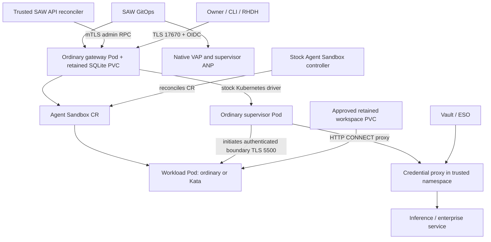

# Stock OpenShell Kubernetes gateway foundation

**Experimental, offline-tested integration.** This chart renders the gateway
foundation; it does not yet install a complete SAW workspace. The parent
`saw-users` and RHDH provisioning gates still reject container/Kata creation.
Do not interpret gateway readiness as agent, inference or policy qualification.

The chart uses the stock ODH OpenShell `v0.1.2-rhaiv.6` component images pinned in
[`values.yaml`](values.yaml), reviewed against source
[`305c8b3`](https://github.com/opendatahub-io/openshell/tree/305c8b3d7bbdb97a6f2f7264c3ad43b0087c307f).
It changes configuration and Kubernetes resources only. No OpenShell, Kata or
Agent Sandbox source patch, derivative image or custom CSI driver is required.

## Topology and ownership



| Object/component | Owner and function |
|---|---|
| Gateway StatefulSet, Service, passthrough Route, configuration and RBAC | This chart; one gateway per user namespace, one replica, persistent state |
| Gateway identity and credential-encryption key | External retained secret owner; the chart only references them |
| Gateway namespace NetworkPolicies | This chart; default deny, explicit gateway ingress/egress |
| Supervisor ANP and runtime VAP | Separate [platform policy chart](../saw-runtime-policies/README.md); verify before workload release |
| Supervisor Pod, Sandbox CR, bootstrap Secrets and stock fences | Stock OpenShell Kubernetes driver; do not concurrently own them in Argo |
| Workload Pod and native Sandbox-owned resources | Stock [Agent Sandbox controller](../../docs/container-runtime-dependencies.md) |
| Approved retained `/sandbox` and data PVCs | Platform/storage owner; referenced by the [SAW API reconciler](../../kubernetes-runtime/README.md) |
| Provider secrets, proxy private CA and proxy | Separate trusted credential namespace; never project private credentials into the runtime namespace |

`workspace_mode: shared` means logical workspaces such as `default` and `cuda-dev`
share this one user's namespace. It does not share a gateway between users.

| Mode | Gateway | Supervisor | Workload |
|---|---|---|---|
| `container` | Ordinary Pod | Ordinary Pod | Ordinary Pod |
| `kata` | Ordinary Pod | Ordinary Pod | Approved Kata RuntimeClass |

Kata is Pod-scoped. The supervisor remains outside the workload VM, and neither
mode provides confidential-computing attestation. The native policy rejects a
different workload class or a supervisor class. Supervisor-in-Kata is a separate
[future proposal](../../docs/proposals/openshell-supervisor-runtimeclass.md).

## Required inputs and trust

Enable `kubernetes.experimental: true` only for source-defined qualification.
Provide these values explicitly; the chart neither discovers nor generates them:

| Input | Contract |
|---|---|
| `deployment.mode` | `container` or `kata`; VM/confidential use different paths |
| `kubernetes.workload.image` | Approved application image pinned by SHA-256 digest |
| `kubernetes.workload.runtimeClassName` | Empty for container; approved, installed class for Kata |
| `kubernetes.storage.className` | Approved filesystem StorageClass; no implicit default |
| `kubernetes.storage.existingGatewayClaim` | Optional independently owned retained gateway state; otherwise this chart creates a retained PVC |
| `kubernetes.identity.*` | Existing retained Secret names, described below |
| `oidc.issuerUrl`, `clientId`, roles | Verified HTTPS issuer and matching client/role contract |
| `oidc.caConfigMap` | Optional public issuer CA bundle, key `ca.crt`; include other needed trust roots if it replaces system trust |
| `kubernetes.proxy.url`, `caConfigMap` | Stock SAW proxy listener and its **public** intercepting CA; private CA remains with proxy |
| `kubernetes.governance.endpoint` | Reviewed governance gRPC endpoint; HTTPS or explicitly configured in-cluster HTTP |
| `kubernetes.network.gatewayEgress` | Actual DNS/API Service and backend addresses, issuer/governance/proxy destinations and ports |
| `kubernetes.network.reconcilerNamespace`, `reconcilerLabels` | Exact trusted caller selector, separate from the runtime namespace |
| `route.host` | Optional assigned hostname; certificate must cover the chosen host |

Names and certificate material are installation inputs. Secret values must not
enter Git. A retained owner must supply:

| Secret reference | Keys and purpose |
|---|---|
| `serverTlsSecret` | `tls.crt`, `tls.key`, `ca.crt`; gateway server certificate/private key and **server** root CA |
| `clientCaSecret` | `ca.crt`; trust root for API client identities; the chart projects only this public key |
| `jwtSecret` | `signing.pem`, `public.pem`, `kid`; persistent gateway signing identity |
| `credentialKeySecret` | `key-encryption-key`; base64 **text** that decodes to 32 bytes, as required by stock OpenShell |

Using `Secret.stringData` for the credential KEK takes the base64 text directly.
Using `Secret.data` requires Kubernetes' additional outer base64 encoding. This
chart generates neither encoding nor the key. Preserve identity and database
together across restarts. Do not rotate them on each Argo sync.

The gateway certificate SANs must cover the actual internal Service name
`<release>-gateway.<namespace>.svc`, peer TLS name
`<release>-gateway.<namespace>.svc.cluster.local`, and any external Route host.
The driver projects only `ca.crt` from `serverTlsSecret` into supervisors: it must
verify the server, not use a distinct client CA. The trusted reconciler needs its
own stock admin client certificate with OU `openshell-admin`, outside the runtime
namespace. mTLS and OIDC are both enabled; unauthenticated users are disabled.

The stock SAW proxy listens on HTTP 3128 and accepts hostname CONNECT targets,
not literal IPs. The configuration sets `proxy_connect_by_hostname = true` and
passes only its public CA into the driver. Include narrowly scoped proxy egress
rules at the trusted namespace: hostname resolution there is an additional trust
step. An HTTPS proxy URL requires a real TLS frontend. The existing governance
service speaks HTTP gRPC on 18081; an HTTPS endpoint likewise requires actual TLS
and trusted server roots. No insecure TLS verification switch is enabled.

## Native policies and resource admission

This chart denies all namespace traffic except explicit gateway paths. The driver
adds workload/supervisor fences. Its supervisor fence permits all egress, so
ordinary NetworkPolicies alone cannot impose the desired supervisor restrictions.
The separate ANP must be realized before sandbox creation.

The policy inputs must match this chart exactly:

```yaml
targetNamespace: <release-namespace>
gatewayId: <release-name>
gatewayServiceAccount: <release-name>-gateway
sandboxServiceAccount: <release-name>-sandbox
mode: kata
kata:
  workloadRuntimeClassName: <same-approved-workload-class>
```

The gateway service account may create Pods and bootstrap Secrets in its own
namespace. This makes that namespace unsuitable for full provider credentials:
Pod creation can expose Secrets through mounts even without Secret GET permission.
The separate credential namespace is a required integration boundary. Read access
to the server Secret is scoped by name; token reviews and reviewed node/namespace
reads are cluster-scoped. This is not a zero-privilege gateway.

Stock resource admission remains enabled. PVC approval labels bind to a logical
workspace; shared RuntimeClass approval requires `openshell.ai/sandbox-attachable:
"true"`. The trusted reconciler additionally binds PVC/Class UIDs and ownership.
No tenant arbitrary PodSpec, Secret mount, service account or hostPath passthrough
is introduced.

## Offline validation and pending installation

The fixture contains documentation-only addresses, a synthetic application digest
and missing Secret references. Use it for rendering only:

```sh
helm template saw-test charts/openshell-saw-kubernetes -n saw-test \
  -f tests/fixtures/saw-kubernetes-values.yaml \
  --api-versions agents.x-k8s.io/v1beta1/Sandbox \
  --api-versions policy.networking.k8s.io/v1alpha1/AdminNetworkPolicy
python3 -m pytest -q tests/charts/test_saw_kubernetes_chart.py
```

Supplying API flags simulates discovery offline; it must never bypass missing
live dependencies. The chart rejects unknown nested fields, unpinned images,
missing trust/storage/network inputs, incompatible runtime fields and missing
experimental opt-in. Config is mounted as a subPath file because stock OpenShell
rejects symlinked config; its checksum rolls the Pod when configuration changes.

The separate `saw-kubernetes-identity` chart now implements retained identity
bootstrap; first and repeated Argo syncs passed on glmhg. Still needed before a
complete deployment: trusted namespace ESO and proxy integration; a concrete ANP/VAP health verifier; reconciler
image/Deployment and full profile adapters; owner/UI/RHDH/CLI lifecycle wiring;
policy API validation and live positive/negative tests. Gateway `/readyz` only
reports the gateway, not these dependencies or full SAW parity. Follow the
[implementation plan](../../docs/container-kata-implementation-plan.md), starting
with its unchanged VM baseline once the replacement cluster is ready.
