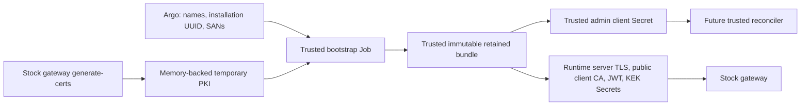

# Retained Kubernetes gateway identity

Experimental additive bootstrap for the stock OpenShell Kubernetes gateway.
Disabled by default. Install in an administrator-owned **trusted namespace**,
separate from the gateway/workload namespace. This chart alone does not deploy a
gateway, reconciler, credential proxy or agent, and is not full SAW parity.



The init container uses the pinned stock `generate-certs` implementation. A
small SAW integration helper issues an `OU=openshell-admin` client certificate,
generates a 32-byte credential-store key, and atomically retains one Secret
before creating projections. The CA private key stays in the memory-backed Job
volume; it is never stored in a Kubernetes Secret. The stock ordinary client
identity is not projected. The helper uses stock Python/OpenSSL, without a new
image build or modification to OpenShell.

| Secret | Namespace | Consumer / retained contents |
|---|---|---|
| `<gateway>-identity` | Trusted | Recovery bundle: selected leaf keys, public CA, JWT identity, KEK; no CA private key |
| `<gateway>-admin` | Trusted | Controller: admin client certificate/key and server trust |
| `<gateway>-server` | Runtime | Gateway server certificate/key and public CA |
| `<gateway>-client-ca` | Runtime | Public CA only |
| `<gateway>-jwt` | Runtime | Gateway sandbox-token signing identity |
| `<gateway>-kek` | Runtime | Gateway credential-store KEK in stock base64-text format |

All Secrets are immutable, have no garbage-collecting owner reference, and carry
`Prune=false,Delete=false`. Ordinary sync never rotates them. The input hash binds
the installation UUID, namespace UIDs, DNS SANs and lifetime. A conflict, namespace
replacement, orphaned projection or changed input fails closed. After a partial
create, the next run resumes from the retained bundle. A concurrent creator's
atomic bundle wins; losing generators never publish their own keys.

Example nonsecret values (not a qualified live installation):

```yaml
enabled: true
ownerID: 67a9891d-e281-442f-86c3-41771f5ce049
targetNamespace: saw-alice
gateway: saw-alice
adminDays: 30
serverSans:
  - saw-alice-gateway.saw-alice.svc
  - saw-alice-gateway.saw-alice.svc.cluster.local
  - gateway-alice.apps.example.test
```

Both namespaces must already have administrator-owned label
`saw.redhat.com/runtime-owner: <ownerID>`. Argo must permit resources in both
namespaces and the narrowly scoped cluster RBAC. A namespace network policy must
allow this Job to reach the Kubernetes API; this chart does not add broad egress.
The later gateway chart references the four runtime Secret names explicitly.
The trusted reconciler receives only the admin projection, not the recovery bundle.

The Sync hook runs after its config/RBAC. A parent application must wait for this
application's successful hook, not merely rely on parent sync-wave numbering.
RBAC allows named Secret reads and namespace-scoped Secret creation only; Kubernetes
cannot restrict `create` by resource name. It grants no update/delete, workload
creation or access to other namespaces. Treat the Job and both namespace
administrators as trusted. Gateway Pod-create privileges make its entire namespace
unsuitable for provider credentials, admin client keys or CA private keys.

**Lifecycle limits:** admin certificates expire after `adminDays` (1–90, default
30). No automatic renewal/rotation is implemented. Rotation must coordinate client
trust, controller identity and gateway state; changing values alone is rejected.
Retain the bundle alongside gateway DB/backups. Namespace deletion still destroys
its Secrets. Init generates temporary candidate PKI on each hook run, but existing
retained identities always win; successful-hook deletion removes the memory volume.

Validation: unit tests cover repeat sync, crashes after each Secret creation,
concurrent creators, namespace replacement, conflicting material and real OpenSSL
admin client issuance. Helm tests check stock image pins, privilege separation,
memory-only generation, deterministic rendering and RBAC. These are offline tests;
live restricted-SCC execution and gateway TLS are separate acceptance gates.
