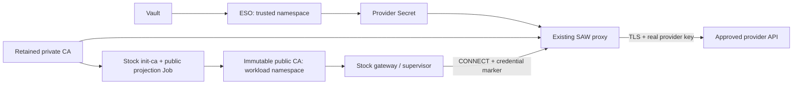

# Trusted Kubernetes credential proxy

Integration packaging for the **existing SAW credential-proxy binary**. This
chart changes no OpenShell, Kata, agent or proxy source. It does not enable the
container/OpenClaw qualification gate.



Install once per workspace trust boundary in a **different, administrator-owned
namespace** from its runtime. Both namespaces must already carry
`saw.redhat.com/runtime-owner: <same nonzero UUID>`. Do not place unrelated or
untrusted writers in the trusted namespace. Runtime pods cannot mount its Secrets.
The proxy has no Kubernetes API token or RoleBinding.

Inputs (`values.yaml`):

| Input | Meaning |
|---|---|
| `enabled`, `ownerID`, `gateway`, `targetNamespace` | Explicit opt-in and retained installation identity |
| `policyConfigMap` | Existing administrator-owned ConfigMap with stock `config.json` policy |
| `policyDigest` | SHA256 of that file; update together with policy to trigger a proxy rollout |
| `credentialSecretNames` | Existing ESO-managed credential Secret names, **never values** |
| `network.bootstrapEgress` | Explicit Kubernetes API and DNS paths for the short-lived Job |
| `network.proxyEgress` | Explicit DNS and provider transport paths; proxy policy restricts HTTPS hosts |
| `image`, `helperImage` | Reviewed immutable image digests |

Example policy for the approved OpenAI provider (credentials stay in ESO):

```json
{"markerPrefix":"saw-cred","allowHosts":["api.openai.com"],"profiles":{"openai":["api.openai.com"]},"bindings":[{"secret":"inference","key":"api_key","providers":["openai"]}]}
```

The caller sends `saw-cred.inference.api_key` instead of the key. Provider profiles,
allowed hosts and bindings must be produced from the same reviewed SAW intent as
the workload policy. This chart deliberately accepts the existing policy contract;
it does not add another provider-profile compiler. Automatic generation from the
Kubernetes reconciler remains a separate integration gate.

The stock `init-ca` command creates its private CA once and reuses it on sync. Its
Secret and trusted public ConfigMap are runtime-created, have no application
ownerReference, and survive Application pruning. The helper reads only public
ConfigMaps and namespace identity; it creates an immutable retained public CA in
the runtime namespace. Different data, foreign ownership, malformed certificates
or deletion-in-progress fail closed. No implicit CA rotation or adoption occurs
in the runtime namespace. Recover lost/corrupt trust through an explicitly reviewed
rotation procedure; deleting the runtime CA is not a routine repair.

Bootstrap's service account can create Secrets only in the trusted namespace and
read only the named CA Secret. It can create ConfigMaps in both namespaces, update
only the named trusted public ConfigMap, and read the named CA ConfigMaps/namespaces.
Kubernetes RBAC cannot restrict `create` by resource name. This short-lived
bootstrap account and the trusted namespace administrators are part of the TCB;
container separation within its Job is not an RBAC boundary.

Only the exact runtime namespace's gateway and supervisor selectors can reach
port 3128. Native runtime admission must prevent impersonating those identities.
No public Route or health Service is exposed. Existing broader NetworkPolicies
are additive: inspect them and enforce the platform AdminNetworkPolicy boundary
before granting a workspace. A ready proxy is not proof of egress isolation.

## Validation

```sh
python3 -m pytest tests/charts/test_saw_kubernetes_proxy_chart.py \
  tests/kubernetes_runtime/test_proxy_ca_projection.py -q
oc -n TRUSTED_NAMESPACE rollout status deploy/GATEWAY-credential-proxy
```

Then sync the Argo Application twice and compare CA Secret UID, public CA
fingerprint and runtime ConfigMap UID. With a disposable approved client, verify a
real provider request using only the marker, rejection of an unapproved host,
rejection of a marker for the wrong host and runtime namespace credential absence.
Do not report container SAW parity until the full workspace/agent/portal tests pass.

The opt-in live transport probe uses only a marker and public CA:

```sh
python3 tests/acceptance/kubernetes_proxy.py \
  --trusted-namespace TRUSTED --runtime-namespace RUNTIME --gateway GATEWAY
```

It creates a temporary loopback-only port-forward, performs one small OpenAI chat
request, rejects an unapproved host and unknown marker, then closes the tunnel.
`--trust-only` compares public trust/metadata without making an inference call.
The port-forward bypasses client-side ingress policy; it cannot qualify CNI.
