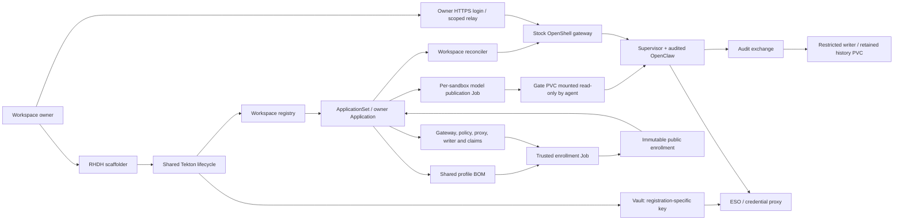

# RHDH container workspaces

An enrolled owner chooses **Container** in the existing RHDH create/update template, selects a site-approved BOM profile, and enters the provider credential. The existing owner picker handles deletion. The portal currently supports one registration per owner. VM is the default deployment.

The deployment selector filters the profile choices. Container choices are the
union of reviewed profiles configured for owners at this site, intersected with
the generated BOM catalog. The backend separately checks approval for the
authenticated owner before writing credentials. A profile available to another
owner is not automatically authorized for yours. With no reviewed container
profile, the form hides Container. Switching deployment may require selecting a
new profile; an existing container registration keeps its original profile.

If a request reports an unapproved profile, use one of the profiles named in the
error or have the administrator configure and qualify the required profile.
Foreground cleanup is a separate prerequisite (`portal.pruneOnRemove: true`).
Neither rejection changes the existing workspace or its stored credentials.

[Install the OpenAI container site and test recovery](../../docs/container-site-replay.md) covers public inputs, image builds, first-time boundary review, owner registration and recovery probes.

### How a profile reaches either runtime

Both deployment methods render `charts/saw-bom` and read the same profile documents. Both use `saw_core` to parse and validate those documents, resolve typed inference inputs and defaults, and order workspace, provider and sandbox creation. The profile catalog lists the enabled workspaces, sandboxes and browser routes. The VM installer supplies its filesystem reader for inference inputs. The Kubernetes adapter supplies public model selections and attaches PVCs to stock OpenShell sandboxes.

Provider eligibility, model preference and native endpoint defaults are also
shared. The VM adapter uses the core's native/custom OpenClaw onboarding
decisions. Transport commands, approved provider capabilities, credential
rotation, object-identity checks and storage recovery remain adapter operations.
In particular, VM migration can archive and recreate a sandbox; the container
controller rejects unexpected replacement and retains its approved claims.

The site approves the rendered BOM digest in `automaticEnrollment.approvedProfiles`. RHDH derives one storage binding per enabled sandbox, and a scoped owner relay for each declared UI. An additional profile using these capabilities needs a digest approval and qualification. A new BOM capability belongs in the shared engine when both runtimes need it, with storage, placement and authorization supplied by the adapters.

| Input or behavior | Owner |
|---|---|
| Enabled workspaces and sandboxes, provider references, agent type, model inputs, image and requested UI routes | The existing SAW BOM and its generated profile catalog |
| Parsing, semantic validation, model defaults and provider attachment ordering | The shared Python engine used by both adapters |
| PVC names and attachment checks, registration-scoped identities, supervisor and workload resources, browser relay forwarding | The Kubernetes adapter and its charts |
| Approved rendered digest, provider endpoint policy and necessary image compatibility override | Operator site values |
| Create/update/delete request, Vault credential handling and catalog links | The shared RHDH/Tekton/ApplicationSet flow |

The glmhg data-science VM BOM enables `default/notebook` (OpenClaw) and `cuda-dev/cuda-sandbox` (NemoClaw running OpenClaw). It uses external OpenAI inference and disables the optional inline harness at this site. NemoClaw uses its original image digest. The AIPCC notebook image sets `/sandbox` to mode 0770 for UID 1000 and group 0. The stock Kubernetes driver uses the OpenShift namespace UID/GID for the workload. The [image build chart](../../image-builder-charts/helm/openshift-home-access) derives the notebook image from the exact VM digest, adds directory traversal with `chmod o+x /sandbox`, and restores the image user. The owner portal passes the resulting digest through the existing `saw-bom.imageOverrides` input. The same BOM sources produce both deployments, with a different reviewed render digest for that image selection. The sandbox keeps the OpenShift-assigned identity.

The two model selectors are public configuration. For new registrations at sites with `modelLifecycle: true`, the same owner form can update either selector. Fixed-model sandboxes keep their BOM value. Existing legacy registrations require re-enrollment for model rollover. A profile change requires a fresh registration. Provider API keys stay on the Vault/ESO/proxy path.




| Step | What happens |
|---|---|
| Create | The shared portal verifies the Backstage caller, looks up the approved owner subject and profile, stores the key in a generation-specific Vault path, and records the registration. Argo renders the same BOM used by VM workspaces. Container mode selects a dedicated gateway instead of a VM. |
| Enroll | A restricted Job compares the live admission, network, gateway, proxy and governance configuration with the site's previously reviewed reference. It checks cluster realization, PVC ownership/UIDs, and the BOM digest; it obtains the audit receipt public key over service-CA-verified TLS. It can patch only its precreated enrollment ConfigMap. It cannot read Secrets via the API, mount audit history or change policy. Its gateway CA mount projects only the public certificate. |
| Start | The portal generator reads the immutable public binding. Argo deploys the gate preparation Job and reconciler. The reconciler verifies the concrete resource UIDs and hashes again before creating the workspace and sandbox via stock OpenShell RPCs. The model key stays in the credential proxy's trusted namespace. |
| Open chat | Keycloak issues a dedicated service-account subject bound to this registration. The membership Job checks the gateway's workspace ID, installation label and owner administrator before granting the relay only the workspace user role. The owner must separately sign in via the registered HTTPS callback. The relay forwards to the sandbox's OpenClaw listener. |
| Use a tool | OpenClaw uses the shared VM tool gate. A mutating call can require an owner decision. The trusted writer commits the record before signing a receipt. The agent mounts an exchange, never the writer's history PVC or signing key. |
| Update | The same form retains the registration and claims and increments intent generation. Readiness requires the current generation, profile UID, and intent/BOM digest, plus a healthy Argo application and a working owner login challenge. |
| Model rollover | Argo publishes the requested model to its bound sandbox's gate PVC before advancing the intent. The controller stops the recorded sandboxes, persists the stop acknowledgement, and starts them using their original OpenShell IDs. Each new process reads its own model. Argo removes superseded Jobs. |
| Stop/start | The owner form or CLI submits the same signed Tekton request. Stop removes workload Pods and scales down the UI relays. Start revalidates the boundary and restores the chats. The gateway, audit writer and claims remain throughout. |
| Delete | The shared deletion pipeline fences the registration and waits for foreground GitOps removal before destroying the scoped Vault data and registry entry. The relay client and callback are removed. The separate history namespace/PVC is retained; a subsequent create gets a different one. |

**Site inputs:** [example values](../../examples/portal-container/glmhg.yaml) contain the authorized owner/Keycloak subject, reviewed chart revisions, image digest, storage classes, gateway and proxy networking, governance namespace, approved BOM digest and boundary reference. These values are operator policy, never form input. A change to a pinned policy, shared governance identity, or approved BOM requires review. The owner enters only the profile, backend and inference key. No OpenShell driver or VM image patch is required.

**Acceptance:** [RHDH owner client](../../tests/acceptance/rhdh_workspace.py) submits the actual installed templates. A returned task ID is not a pass: wait for the Backstage task **and** Tekton PipelineRun. [Chat client](../../tests/acceptance/openclaw_audit_chat.py) signs in to the real HTTPS/WSS route, reads an unpredictable canary, and resolves tool approval requests as the owner. Also check the actual disposable files. [Archive verifier](../../tests/acceptance/portal_audit_evidence.cjs) checks the decision sequences and hashes the ordered records for comparison after deletion.

**Audited OpenClaw validation (glmhg, 2026-11-05):** the owner’s create, update and delete tasks all completed in RHDH and succeeded in Tekton. Generation 2 retained the same sandbox and history PVC. Five expected tool-gate records matched byte-for-byte after foreground deletion and an independent read-only remount. The [validation record](../../tests/acceptance/portal-container-validation-2026-11-05.json) includes run IDs, digests and the two issues encountered during qualification.

**Data-science validation (glmhg, 2026-11-05).** RHDH completed create, update and delete. Both owner chats read unique canaries, denied and approved disposable deletions, and answered fresh prompts after update. Each restricted read-only verifier recovered five matching audit records after delete. The update reapplied the selected models. See the [live receipt](../../tests/acceptance/data-science-container-validation-2026-11-05.json) for both archive hashes, pipeline times and the original notebook permission failure.

**Model and power lifecycle on glmhg.** Both data-science chats served their newly selected models after rollover and again after owner stop/start. OpenShell object IDs, PVC UIDs and canary contents survived the new Pods. Each archive retained five matching audit records after workspace deletion. The live test resumed on the same registration after correcting an unavailable provider model. [Validation record](../../tests/acceptance/owner-model-lifecycle-2026-11-05.json)

### Repeat the owner lifecycle

Use an enrolled **disposable owner with no current registration or runtime namespace**. Use an operator `oc` context for the same cluster. The harness needs read access to registration/runtime state, workspace exec for test fixtures, and permission to run a restricted read-only verification Job in the resulting audit namespace. These permissions are for the test observer, not the RHDH user.

```sh
python3 tests/acceptance/portal_container_lifecycle.py \
  --user "$TEST_OWNER" --portal "$RHDH_URL" --issuer "$KEYCLOAK_REALM_URL" \
  --domain "$CLUSTER_DOMAIN" --profile "$PROFILE" \
  --password-file "$OWNER_PASSWORD_FILE" --key-file "$INFERENCE_KEY_FILE"
```

The final JSON contains three Backstage task IDs, the archive PVC UID, decision sequences and a before/after SHA-256. An intermediate task ID or PipelineRun does not indicate completion. On a failed step the harness stops and leaves evidence for inspection. To retry a clean cycle, first inspect the task and remove only the disposable registration using the normal RHDH delete template. The harness reads the public UI build ID from each installed sandbox package for the signed browser handshake.

To exercise model changes and power management, install the owner CLI dependencies
in the same Python environment as the harness (`python3 -m pip install ./cli`).
Use two chat models enabled for the test account. For the OpenAI data-science
profile, append these arguments to the command above:

```sh
  --model inference__model=gpt-4.1-mini --model inference__cuda_model=gpt-4.1-mini \
  --update-model inference__model=gpt-4.1 --update-model inference__cuda_model=gpt-4o-mini
```

The test verifies both changed Pod UIDs, stable OpenShell IDs and PVC UIDs,
fresh provider completions for the expected model in each sandbox, owner stop
and start, provisioning logs, file persistence and retained audit records.
A provider can reject a model even when Kubernetes and the owner route report
ready. The nonce-matched completion and provider response model are the inference
checks.

### Personal assistant and inline harnesses

The VM and Kubernetes backends consume the same rendered `saw-bom-profiles`
ConfigMap. For `personal-assistant` it contains the sandbox and provider
declarations, the base64-encoded `daily-briefing` files and Helm's digest index.
The VM installer and Kubernetes runtime import one implementation of bundle
parsing, digest checking, provider-governance checks, skill discovery paths and
OpenClaw MCP configuration. The shared credential-proxy policy template reads
the existing governance profiles and the selected user's credential bindings.
`scripts/saw-profile-catalog.py --check` verifies the packaged chart copies.

| Component | What it does on Kubernetes |
|---|---|
| Enrollment | Verifies the complete BOM against the administrator-approved digest. Binds the selected inline harness name and digest to the signed-tool-gate slot. An absent required bundle, changed tree or missing provider blocks compilation. |
| Publication Job | Recomputes the mounted BOM's tree digest, then atomically publishes the verified files under a digest-derived directory on the slot's trusted gate PVC. A replay verifies the existing files. |
| Stock OpenShell and agent | OpenShell mounts that directory read-only at `/sandbox/harness` and the writable workspace's briefing subtree at `/sandbox/briefing`. The agent verifies the actual mount mode and digest before enabling the bundle. The skill, readers and writer are the VM bundle bytes. |
| Provider proxy | ESO projects the static Slack bot token and Gmail OAuth refresh material into the registration's trusted namespace. The existing broker handles token refresh. Agent MCP processes use provider markers. Approved destination and method rules come from the stock governance profiles. |

For live enrollment, pin a runtime image with harness support. Add the profile's
rendered BOM SHA to `automaticEnrollment.approvedProfiles`, pin the assistant
image under `profileImageOverrides.personal-assistant.assistant`, and supply
`profileBoundaries.personal-assistant` alongside `automaticEnrollment` in the
site's owner entry. Its `reference` is the reviewed boundary map for this
owner/profile and its `allowHosts` for the shipped NVIDIA profile are
`integrate.api.nvidia.com`, `slack.com`, `gmail.googleapis.com` and
`oauth2.googleapis.com`. RHDH collects the existing VM profile inputs.
The host list controls broker egress. The selected provider profiles constrain
where each credential can be injected. Use the profile-specific reviewed
reference because the broker's mounts and configuration differ from data science.

**Repeat the credential-free OpenShift test.** Run from the repository root
with Python, PyYAML, Helm and an operator `oc` context. Use a namespace able to
pull the pinned runtime image. The Job uses restricted admission, disables the
service-account token, and runs its fixture services on loopback. Choose a
unique suffix. Wait for completion before removing the labeled test resources.

```sh
ns=saw-k8s-build
id=briefing-$(date +%s)
python3 tests/acceptance/briefing_fixture.py --runtime-image "$RUNTIME_IMAGE" --suffix "$id" |
  oc -n "$ns" create -f -
oc -n "$ns" wait --for=condition=complete "job/briefing-fixture-$id" --timeout=21m
oc -n "$ns" logs "job/briefing-fixture-$id" -c agent
oc -n "$ns" delete job,configmap,networkpolicy -l "saw.redhat.com/fixture=briefing-fixture-$id"
```

The fixture compiles the shipped personal-assistant BOM, publishes the harness,
and starts the pinned NemoClaw image with the generated startup checks. It runs
OpenClaw locally in the test Pod, with the SAW audit writer and forwarder,
synthetic Slack/Gmail endpoints and a deterministic model. The direct reader
test checks both denials and the saved briefing. The conversation test checks
the agent's response with both sources available and each source denied in
turn. Live OAuth exchange, real inference, stock OpenShell provisioning and
RHDH owner-route qualification for this profile require a separate live run.
OCI harness-image delivery is outside this inline-bundle test.

On glmhg, the tested controller image digest was
`sha256:d62e4bccf1f455bce1a014298545cd5db8d361dd158eccbcf7a6d7949e26a5c6`
in `image-registry.openshift-image-registry.svc:5000/saw-k8s-build/saw-runtime-controller`.
[OpenShift qualification record](../../tests/acceptance/personal-assistant-container-fixture-2026-11-05.json)
