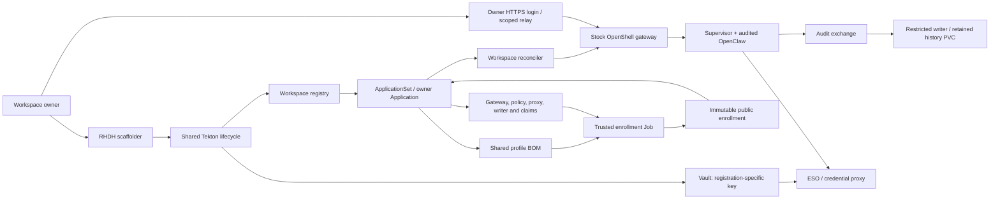

# RHDH container workspaces

An enrolled owner chooses **Container → Audited OpenClaw** in the existing RHDH create/update template and enters an inference key in its secret field. Delete uses the existing owned-workspace picker. An owner has one portal registration at a time. VM remains the default; an existing workspace cannot switch backends in place. This path uses ordinary Pods, not Kata or confidential VMs.

| Step | What happens |
|---|---|
| Create | The shared portal verifies the Backstage caller, looks up the approved owner subject and profile, stores the key in a generation-specific Vault path, and records the registration. Argo renders the same BOM used by VM workspaces. Container mode selects a dedicated gateway instead of a VM. |
| Enroll | A restricted Job compares the live admission, network, gateway, proxy and governance configuration with the site's previously reviewed reference. It checks cluster realization, PVC ownership/UIDs, and the BOM digest; it obtains the audit receipt public key over service-CA-verified TLS. It can patch only its precreated enrollment ConfigMap. It cannot read Secrets via the API, mount audit history or change policy. Its gateway CA mount projects only the public certificate. |
| Start | The portal generator reads the immutable public binding. Argo deploys the gate preparation Job and reconciler. The reconciler verifies the concrete resource UIDs and hashes again before creating the workspace and sandbox via stock OpenShell RPCs. The model key stays in the credential proxy's trusted namespace. |
| Open chat | Keycloak issues a dedicated service-account subject bound to this registration. The membership Job checks the gateway's workspace ID, installation label and owner administrator before granting the relay only the workspace user role. The owner must separately sign in via the registered HTTPS callback. The relay forwards to the sandbox's OpenClaw listener. |
| Use a tool | OpenClaw uses the shared VM tool gate. A mutating call can require an owner decision. The trusted writer commits the record before signing a receipt. The agent mounts an exchange, never the writer's history PVC or signing key. |
| Update | The same form retains the registration and claims and increments intent generation. Readiness requires the current generation, profile UID, and intent/BOM digest, plus a healthy Argo application and a working owner login challenge. |
| Delete | The shared deletion pipeline fences the registration and waits for foreground GitOps removal before destroying the scoped Vault data and registry entry. The relay client and callback are removed. The separate history namespace/PVC is retained; a subsequent create gets a different one. |

**Site inputs:** [example values](../../examples/portal-container/glmhg.yaml) contain the authorized owner/Keycloak subject, reviewed chart revisions, image digest, storage classes, gateway and proxy networking, governance namespace, approved BOM digest and boundary reference. These values are operator policy, never form input. A change to a pinned policy, shared governance identity, or approved BOM requires review. The owner enters only the profile, backend and inference key. No OpenShell driver or VM image patch is required.

**Acceptance:** [RHDH owner client](../../tests/acceptance/rhdh_workspace.py) submits the actual installed templates. A returned task ID is not a pass: wait for the Backstage task **and** Tekton PipelineRun. [Chat client](../../tests/acceptance/openclaw_audit_chat.py) signs in to the real HTTPS/WSS route, reads an unpredictable canary, and resolves tool approval requests as the owner. Also check the actual disposable files. [Archive verifier](../../tests/acceptance/portal_audit_evidence.cjs) checks the decision sequences and hashes the ordered records for comparison after deletion.
