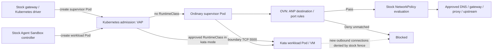

# Native policies for stock OpenShell runtimes

This platform-owned chart adds an OpenShift `AdminNetworkPolicy` (ANP) and a
native Kubernetes `ValidatingAdmissionPolicy` (VAP) with its binding. It installs
no controller, mutator, custom OpenShell binary, or RuntimeClass. It is disabled
by default. Rendering and rule-boundary tests run offline; admission and packet
enforcement still require the cluster acceptance tests below.

| Deployment mode | Supervisor | Workload | Admission rule |
|---|---|---|---|
| `container` | Ordinary Pod | Ordinary Pod | Neither role may select a RuntimeClass. |
| `kata` | Ordinary Pod | Kata Pod/VM | Workload must select the configured class; supervisor must omit it. |

`kata` currently isolates **the workload only**. RuntimeClass absence means the
cluster's default runtime; confirm that default is the intended ordinary
container runtime. Placing the supervisor in a second Kata VM is a
[future proposal](../../docs/proposals/openshell-supervisor-runtimeclass.md).

## Why these policies exist

The pinned stock driver separates supervisor and workload Pods. Its workload
NetworkPolicy permits supervisor-initiated boundary connections and blocks new
workload egress. Its supervisor NetworkPolicy has an unrestricted egress rule.
Adding another restrictive ordinary NetworkPolicy cannot narrow that additive
allow. See the pinned
[driver fence](https://github.com/opendatahub-io/openshell/blob/305c8b3d7bbdb97a6f2f7264c3ad43b0087c307f/crates/openshell-driver-kubernetes/src/isolation.rs#L109).

The ANP selects only the named tenant namespace, supervisor role, and gateway
identity. Approved destinations use `Pass`, delegating to existing
NetworkPolicies; a final IPv4/IPv6 `Deny` blocks everything else. It never grants
ANP `Allow` to workloads. OpenShift evaluates ANPs ahead of ordinary
NetworkPolicies; a Baseline ANP cannot provide this override.
[OpenShift ANP semantics](https://docs.redhat.com/en/documentation/openshift_container_platform/4.22/html/network_security/admin-network-policy)

The stock driver's `default_runtime_class_name` is only a workload default:
template/caller configuration can override it. The VAP enforces the selected
mode on admitted Pods, including replacement Pods. It also preserves the
reserved ServiceAccount, role, Sandbox owner reference and supervisor gateway
identity; supervisor creation must originate from the configured gateway
ServiceAccount. UPDATE checks include the old object, so removing labels cannot
escape the checks. Owner references and labels are not credentials: namespace
RBAC must still prevent untrusted Pod creation or policy changes.
[Stock class selection](https://github.com/opendatahub-io/openshell/blob/305c8b3d7bbdb97a6f2f7264c3ad43b0087c307f/crates/openshell-driver-kubernetes/src/driver.rs#L6390)



The boundary port is configurable in OpenShell; `5500` is its default. ANP rules
must follow the configured value. The supervisor's health listener is `5501`,
not the workload boundary endpoint. No new cross-Pod shared socket is added.

## Inputs and ownership

Install one policy release per dedicated tenant namespace before allowing that
workspace gateway to create sandboxes. Its Argo application needs explicit
permission to own the three cluster-scoped policy kinds. The gateway's
namespace NetworkPolicy permissions do **not** need ANP or admission-policy
write access.

| Input | Required meaning |
|---|---|
| `enabled` | Opt in after native API/network prerequisites have passed. |
| `targetNamespace` | Exact tenant namespace; empty and system namespaces are rejected. |
| `gatewayId` | Exact stock driver `gateway_id` / supervisor label. |
| `gatewayServiceAccount` | Account under which this gateway calls the Kubernetes API. |
| `sandboxServiceAccount` | Stock driver `service_account_name`, shared by its runtime Pods. |
| `mode` | `container` or `kata`; confidential mode is not implemented here. |
| `kata.workloadRuntimeClassName` | Required only for `kata`; must match the driver default. |
| `network.priority` | Explicit administrator allocation, `0..99`, unique among overlapping ANPs. |
| `network.egress[]` | Named destination/port rules; chart fixes action to `Pass`. |

Minimal structure (destinations and selectors are examples, **not site discovery**):

```yaml
enabled: true
targetNamespace: saw-alice
gatewayId: saw-alice-gateway
gatewayServiceAccount: saw-alice-gateway
sandboxServiceAccount: saw-sandbox
mode: kata
kata:
  workloadRuntimeClassName: kata
network:
  priority: 70  # allocate after reviewing existing ANPs
  egress:
    - name: workload-boundary
      to:
        - pods:
            namespaceSelector:
              matchLabels:
                kubernetes.io/metadata.name: saw-alice
            podSelector:
              matchLabels:
                openshell.ai/boundary-role: workload
      ports:
        - portNumber: {protocol: TCP, port: 5500}
    # Also include this site's DNS, gateway, credential proxy and any required
    # telemetry/provider destinations. Without them the supervisor cannot start.
```

[The render fixture](tests/container-values.yaml) demonstrates the full rule
shape, including IPv6 and DNS. Its documentation IPs are not usable endpoints.
Discover actual Service/backend addresses, namespace/Pod labels and ports;
OpenShift DNS service port and backend port can differ. CIDRs, namespace peers
and Pod peers are supported; this chart intentionally supports explicit numeric
ports only. The ANP is an IP/port guardrail, not an FQDN or application-policy
engine. Review approved CIDRs and proxy routing rather than passing all internet
destinations. Rule names must be unique; empty selectors and default-route Pass
CIDRs are rejected.

## Dependencies and release gates

1. **Stock platform:** supported OpenShift OVN-Kubernetes with the ANP API and
   enforcement, plus native `admissionregistration.k8s.io/v1` VAP/Binding APIs.
   No Kyverno or feature-gate change is required.
2. **Kata mode:** install supported OpenShift sandboxed containers first;
   verify the chosen RuntimeClass, schedulable nodes, capacity and compatible
   storage. Configure the stock driver's workload default. With resource
   admission enabled, the class also needs the administrator's
   `openshell.ai/sandbox-attachable: "true"` authorization label.
   [Stock shared-resource admission](https://github.com/opendatahub-io/openshell/blob/305c8b3d7bbdb97a6f2f7264c3ad43b0087c307f/crates/openshell-driver-kubernetes/src/resource_admission.rs#L97)
3. **Policy ownership:** reserve the namespace and runtime ServiceAccount; only
   trusted platform actors may alter ANP priority, policy/binding, RuntimeClass,
   gateway configuration or Pod role identity. Review all earlier-priority ANPs:
   an earlier matching `Allow` or `Pass` can bypass this chart's later rule.
4. **Before workload release:** validate native API schemas and CEL type-check
   status, confirm ANP realization, then run the negative admission/network
   cases below. Chart API discovery checks and sync waves alone do not establish
   that packets are blocked. A separate Argo application requires an explicit
   dependency/health gate; waves do not order separate applications globally.

VAP uses `failurePolicy: Fail` and the binding uses `validationActions: [Deny]`.
That rejects invalid matching requests while the policy is installed; it cannot
protect against the policy itself being absent. The stock gateway does not
verify this ANP, its presence, or its CNI realization. Keep workspace provisioning
disabled until the platform gate succeeds. These are integration requirements,
not additional OpenShell features.
[Native admission behavior](https://kubernetes.io/docs/reference/access-authn-authz/validating-admission-policy/)

All three objects use Argo `Prune=false` to avoid accidental removal of a live
guardrail. To retire a tenant: stop its gateway/workloads first, remove the policy
objects through a reviewed platform change, then remove the namespace/release.
This annotation is Argo behavior, not protection against a direct delete or
`helm uninstall`.

## Validation

Offline, from the repository root:

```sh
python3 -m pytest -q tests/charts/test_saw_runtime_policies.py
helm template saw-runtime-policies charts/saw-runtime-policies \
  -f charts/saw-runtime-policies/tests/container-values.yaml \
  -f charts/saw-runtime-policies/tests/kata-values.yaml \
  --api-versions policy.networking.k8s.io/v1alpha1/AdminNetworkPolicy \
  --api-versions admissionregistration.k8s.io/v1/ValidatingAdmissionPolicy
```

Expected: **56 tests pass**, and rendering produces exactly ANP, VAP and binding.
The explicit API flags simulate discovery for offline rendering only. They do
not install APIs or demonstrate their availability.

Cluster acceptance remains required before enabling workspace provisioning:

| Check | Required result |
|---|---|
| Server-side dry-run of rendered site manifests; inspect VAP `status.typeChecking` | No schema or expression warnings. |
| Wrong/missing workload class in `kata` mode; nonempty supervisor class | Pod creation denied by this VAP. |
| Supervisor created by an account other than its gateway | Denied, including a forged correct role/gateway label set. |
| Removing/changing existing runtime role/gateway identity | Denied on UPDATE. |
| Correct gateway-created supervisor + controller-created Kata workload | Both admit; supervisor default runtime, workload approved Kata RuntimeClass. |
| Required supervisor-to-gateway, DNS, proxy and boundary flows | Pass; OpenShell initialization and session work. |
| Unapproved supervisor destination/port in both available IP families | Blocked despite stock supervisor NetworkPolicy allowing all egress. |
| Workload-initiated DNS, API and arbitrary upstream connection | Blocked by the unchanged stock workload fence. |
| New generation / gateway restart / Pod replacement | Same placement and network restrictions; session identity proof still succeeds. |
| Second tenant | Its Pods and policy are unaffected. |

The Python suite checks rendered objects, unsafe-input rejection and ordered
ANP peer/port matching. It does not execute Kubernetes CEL or OVN; do not record
the pending checks above as live results.
