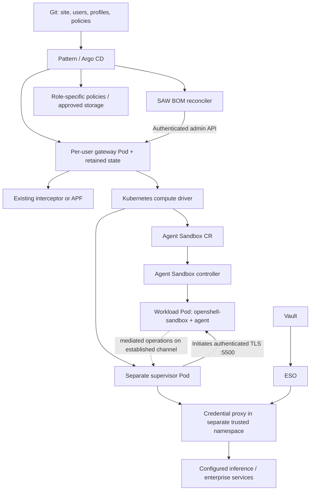
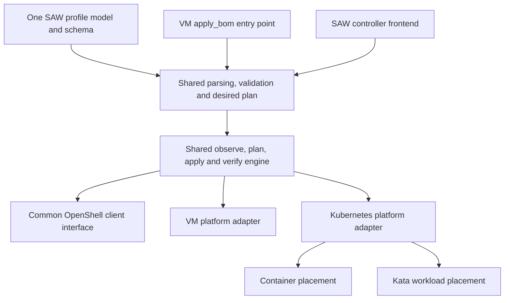
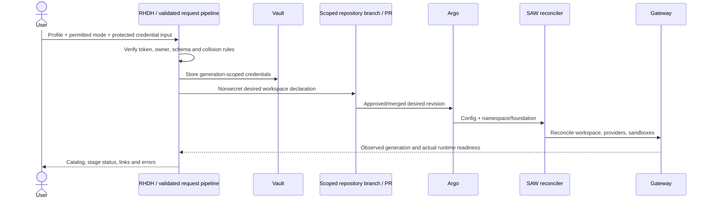

# SAW container and Kata backends: implementation and qualification plan

Status: **VM inference/model recovery verified; portal model update verified through the documented restart; portal status/deletion gaps remain; ordinary container owner create/update/delete verified for audited OpenClaw and both data-science sandboxes (2026-11-05); Kata activation blocked by worker firmware. Full container/Kata SAW parity is not yet implemented.**
Research date: 2026-11-04. Repository: `pmatouse/secure-agent-workspace`.
Planning branch: `plan/container-kata-deployment`. Implementation branch: `dev/container-kata-deployment`.

The original VM baseline and rollout history below are dated. For the implemented RHDH container flow, see [automatic enrollment and owner lifecycle](../charts/saw-portal-container/README.md). The container profile uses the stock OpenShell Kubernetes driver. Kata is a separate qualification.

### Live baseline receipt (2026-11-04)

Latest qualification checkpoint (earlier paragraphs below preserve the rollout
history, including failed attempts):

| Gate | Current evidence |
|---|---|
| VM baseline | Both retained VMs passed owner inference, undeclared-egress denial and restart/persistence; first VM also passed real OpenClaw browser/tool tests |
| Portal create | Recovery run passed; separate portal VM returned `SAW_PORTAL_VM_OK` in authenticated OpenClaw chat |
| Portal model update | Vault/ESO contain the new model; boot-time input disks require the documented restart. Guest selected the new model and its authenticated browser returned `SAW_MODEL_UPDATE_OK`. Portal HTTP-status task failed separately; Tekton success is insufficient |
| Agent Sandbox dependency | Stock controller Available, CRD Established; isolated nonroot `restricted-v2` probe Ready with retained PVC, no token and deny-all network policy; GitOps suspend/resume passed with a fresh Pod and unchanged canary/PVC |
| Retained identity | First bootstrap and second Argo sync passed; six immutable Secret UIDs and public CA fingerprints unchanged |
| Native policies | Installed by Argo; no CEL warnings, OVN SetupSucceeded. Six server dry runs: ordinary Pod and legitimate StatefulSet controller admitted; forged workload, supervisor, gateway label and gateway owner rejected. Packet tests still required |
| SAW policy image | Full build/push passed: `sha256:9f9ceabf338d0265cbedd78df6c27721b1616175c64dc022556d7554caa60b97`; existing VM service unchanged; isolated service 1/1 Available; protocol/policy qualification pending |
| Trusted proxy | Existing SAW binary deployed separately with ESO; real marker-only OpenAI chat returned `SAW_PROXY_OK`; unapproved host and unknown marker denied; repeat sync preserved CA fingerprint and both CA resource UIDs. Port-forward test does not qualify client-side CNI |
| Stock Kubernetes gateway | 1/1 Ready under `restricted-v2`, driver connected, eight governance bindings initialized; ordinary owner passed stock CLI `workspace list` through verified TLS/OIDC. In-cluster issuer uses the internal ingress VIP; generic lifecycle passed; OpenClaw agent qualification remains open |
| Generic container lifecycle | Git generations 7/8/9 reached GenericReady, Stopped and GenericReady. Both restricted-v2 Pods were replaced. The ordinary owner verified a fresh nonce on the same PVC; direct API egress and cross-owner access were denied. [Receipt](https://github.com/pmatouse/secure-agent-workspace/blob/23b8a94/docs/evidence/glmhg-stock-container-lifecycle.json) |
| OpenClaw container | Stock OpenClaw 2026.9.6, private provider proxy, exact owner chat reply and model verified, owner CLI forward served the UI, nonmember denied. Stock gateway token rejected an unauthorized request and the agent refused exec under the deny-all tool policy. [Live receipt](https://github.com/pmatouse/secure-agent-workspace/blob/3d6023d/docs/evidence/glmhg-container-openclaw.json) |
| Container UI relay | Dedicated Keycloak service account lists only agent. Owner catalog and UI login passed, nonmember denied. Signed browser-protocol WebSocket and ordinary CLI returned fresh chat replies. [Receipt](https://github.com/pmatouse/secure-agent-workspace/blob/a20e0dc46aafa78992c565c09da28e0341dbc4c2/docs/evidence/glmhg-keycloak-relay.json) |
| Kata prerequisite | Both worker nodes have KVM/CPU virtualization, but boot in BIOS. OSC 1.13 documents UEFI. Stock operator installation is separate; no KataConfig, forced eligibility or reboot requested |

The trusted credential proxy is now wired and transport-tested. The stock gateway now passes
startup and authenticated read-only RPC. The reconciler runs under Argo with retained state and validates live boundary
objects against reviewed UID/spec pins. It created the `toolbox` workspace.
An ordinary OIDC owner read it and the second user received a membership denial.
Sandbox creation additionally needs matching compiler, governance and stock
driver mount contracts. The pinned driver reserves both the volume name
`workspace` and the mount root `/sandbox`. The external PVC uses
`saw-workspace` at `/sandbox/workspace`. The generic lifecycle and direct API denial passed on the live cluster. Container
OpenClaw inference passed. Owner browser SSO and the RHDH catalog link passed. SAW tool approvals, persistent
tool audit and RHDH provisioning lifecycle parity remain open. The qualification governance endpoint uses network-
isolated HTTP, so transport-level caller authentication is still a production gap. The dependency probe bypasses
OpenShell intentionally to test Agent Sandbox alone; it must never be reported
as a working SAW container workspace. The documented Kata path needs a
UEFI-provisioned worker before runtime activation. See the
[OSC installation prerequisites](https://docs.redhat.com/en/documentation/openshift_sandboxed_containers/1.13/html/deploying_openshift_sandboxed_containers_on_bare-metal_servers/install-osc-overview_metal-osc).


The replacement `glmhg` cluster is OpenShift **4.22.20**. Its authentication
operator recovered after the provisioned Keycloak realm import completed.
Cluster identity, default RBD storage and worker `/dev/kvm`/VMX were checked.
The separate [site/glmhg-vm-baseline branch](https://github.com/pmatouse/secure-agent-workspace/tree/site/glmhg-vm-baseline)
started at the researched upstream revision with site inputs only; initial
bootstrap revision is `ce84127f61726f42846084da9cfeac7528b703e6`. Later recovery
adds the optional Keycloak resource-values input described below; runtime
component images and operator code remain stock.

The user selected the official OpenAI API instead of NVIDIA. Both baseline
workspaces use `gpt-4.1-mini`; the RHDH catalog/forms were regenerated with
`make catalog`. A direct provider completion passed, but this does not qualify
SAW workload inference. Web search is explicitly off pending a search credential.
Credential-proxy mode remains enabled. The user explicitly authorized staging
the private OpenAI input on the supplied bastion and loading it into Vault.

`make prereqs-check`, catalog checks, BOM and canary-user renders passed.
The stock golden image was mirrored by the documented in-cluster target, with
the source index digest preserved. Stock OpenShell CLI 0.1.2 was checksum-verified.
The standard `pattern.sh make install` runs on the Linux bastion to avoid large
laptop downloads. The first rootless Podman `storage-chown-by-maps` operation
was too slow on this nested lab storage. That attempt was stopped before any
Ansible task ran; its log is retained. The wrapper's existing `EXTRA_ARGS`
input selects the following runner configuration, without changing its source:

```bash
export EXTRA_ARGS="--userns=keep-id:uid=0,gid=0 --user=0:0 -v /home/lab-user:/root"
./pattern.sh make install SSH_KEY_PATH=/home/lab-user/.saw-private/glmhg/sandbox-ssh
```

Podman still runs as unprivileged `lab-user`. UID 0 inside the utility container
maps to that user through the rootless namespace; it is not bastion root. The
extra home alias makes the same private input directory available to the
utility's root account. A read-only probe verified cluster access and the exact
source revision before installation. This changes the bootstrap runner, not
SAW guest privileges, credentials policy or deployment code. See
[Podman's user-namespace documentation](https://docs.podman.io/en/stable/markdown/podman-run.1.html#userns-mode).

Full platform convergence, VM inference, owner isolation and RHDH acceptance
are still pending. Patterns operator `0.0.82` and OpenShift GitOps `1.21.7`
have been installed by the framework; `vp-gitops` reports Available. The root
Application references the intended site branch. Startup webhook and default
AppProject ordering errors were allowed to recover through their controllers;
no resources were patched to bypass them. See the
[site inputs and artifact receipt](https://github.com/pmatouse/secure-agent-workspace/blob/site/glmhg-vm-baseline/docs/glmhg-vm-baseline.md).

The first platform run timed out waiting for Vault authentication because the
External Secrets operator bundle exceeded OLM's ten-minute unpack deadline.
Site recovery commit `01a6c4f` adds a 30-minute timeout and ten-minute automatic
retry interval through stock clustergroup `extraObjects`. The same OperatorGroup
identity and scope are retained; a render comparison verifies only the two
annotations change. Argo applied them and OLM advanced to an InstallPlan without
manual Job deletion. CNV's missing PriorityClass also appeared through its
controllers, and its Application reached Synced/Healthy. Operator and workload
readiness must still be checked separately.

The original installer exited at its Vault-auth wait. Once ESO and the stock
unseal job were ready, the documented `pattern.sh make load-secrets` completed
with exit code zero. Vault's store is Ready and the RHDH ExternalSecrets report
SecretSynced. No second full install or hand-created Vault auth state was used.
Keycloak realm import also completed successfully; a shutdown exception in its
log was not an import failure (Job Complete and RealmImport Done were verified).

The nested control-plane VM measured 72.65% CPU steal in a five-second sample,
with a one-minute load average of 96.25. Under this contention, both stock
`virt-operator` Pods repeatedly failed their liveness probes. Site revision
`127f295` raises CNV Subscription resource requests to `250m` CPU / `512Mi`
memory per operator container through supported OLM configuration. Both
`virt-operator` replicas then became Ready. HyperConverged subsequently reported
Available=True, Progressing=False, Degraded=False and Upgradeable=True; all five
virt-handler Pods were Ready. No probes were changed.

SAW's Keycloak chart did not expose the operator's supported resource field.
The optional `keycloak.resources` input now forwards to Keycloak CR
`spec.resources`; empty defaults preserve existing behavior and existing-server
mode does not modify the shared server. The integration is present on both
branches, with all 28 Keycloak chart tests passing. Site revision `033cc1b`
requests `500m` CPU and preserves the `1700Mi` request / `2Gi` memory limit,
with no CPU limit. The RHBK operator owns the rollout; no Keycloak code, image,
probe, realm or authentication policy is changed. This small chart input is the
only integration code addition to the otherwise stock VM baseline so far.

The unhealthy original Keycloak Pod blocked its StatefulSet's OrderedReady
rollout. Site commits `0b7153e` and `4cef018` used the existing `keycloak.instances`
input to scale to zero, observe the server Pod disappear, then restore one.
The replacement Pod has the intended `500m` CPU request. PostgreSQL, its PVC and
the completed realm import were retained; no direct Pod deletion or StatefulSet
patch was used. Fresh installs start with one replica and the final resource
request. The replacement server, Keycloak CR, owner resolver and redirect
registrar subsequently became Ready; the new server had no restarts.

RHDH's dynamic-plugin, RAG-data and CA-bundle init containers all completed with
exit code zero. Both application containers became Ready, and the standard
Keycloak-client hook completed, including catalog-reader roles and the default
user group. The documented `pattern.sh make argo-healthcheck` then exited zero:
all ten platform Applications were Synced/Healthy.

Two-user VM inputs passed `make prereqs-check`, including enabled network
policies. After platform readiness, site commit `d1b5e39` declares `sawvmowner`
and `sawvmother`, each with the data-science profile and NetworkPolicy enabled.
The staged YAML exactly matches the successful preflight input and renders six
child Applications. Account creation uses stock `make keycloak-add-users`;
passwords remain in its Kubernetes Secret. Cluster-published `virtctl` 1.8.4 is
installed on the bastion. Both root disks imported and both VMs reached Running.
Full VM/RHDH acceptance is pending.
This is a recovery run, not clean replay evidence.

The first VM completed component installation but OpenClaw `2026.9.6` rejected
`openai/gpt-4.1-mini` while validating `agents.entries.main.model`. Its local
OpenAI catalog was empty before the agent gateway started, although the live
provider API independently listed this model. The wildcard runtime setting was
already correct. Site commit `9a15f37` uses the supported sandbox inputs
`inference.protocol: openai` and `inference.baseUrl: https://api.openai.com/v1`
to register the requested model explicitly. This is site configuration, not an
OpenClaw or OpenShell code change; generic defaults stay unchanged here. The
official-provider regression suite passes all 42 cases. Argo adopted the site
inputs before the documented restart; the first VM retained its root PVC and
completed install/apply at 19:13:21/19:30:44 UTC. Both sandboxes passed real
provider inference, undeclared-egress denial and gateway-backed OpenClaw `read`
with effective model `gpt-4.1-mini-2025-04-14`. Second-user access was denied
with gRPC status 7. Notebook SSO/chat and tool-denial audit passed, including
verification that the forbidden file was not created. The CUDA-profile UI also
returned a completion but displayed failed-attempt messages; its agent receipt
reports rerouting. Clean single-attempt UI behavior remains to be investigated.
Full credential-file scanning passed: no upstream provider key was found in the
VM, no full provider Secret was attached, and CA/admin cleanup passed. Restart
persistence and second-VM recovery now passed: both original root PVC identities
were retained, both canary hashes matched after a fresh first VMI, and all four
sandboxes passed post-restart provider inference/egress checks. RHDH self-service
create/update/delete remains pending. No runtime image, probe or enforcement
setting was changed. Stock signing remains warn/unsigned, not enforced.

RHDH's real sign-in test exposed a cached startup OIDC discovery failure: the
provider retained an initial HTTP 503 although live discovery from the backend
now returned 200. The shared chart adds a public-metadata/TLS startup check before
RHDH initializes that stock provider. No RHDH image or authentication policy is
changed. Tests pass (55 on this branch); site `0c318c5` is Argo Synced and its
operator-owned replacement passed discovery and rolled out. Ordinary portal login
now works. Site `1438671` also explicitly disables the unused Brave provider and
regenerates its form; runtime BOM data is unchanged. The normal portal form
submitted `saw-create-27v4p` for disposable user `sawportalvm`; request validation,
Vault registration, Argo applications and VM creation passed. The first run
exceeded its 30-minute wait. A normal resubmission with the documented 60-minute
site input succeeded around 21:29 UTC after cold image pulls completed. The new
VM passed owner exec, both provider completions, both undeclared-egress denials,
and an actual OpenClaw browser reply `SAW_PORTAL_VM_OK`.

A model-update request reached Vault/ESO but the guest retained its old model:
this baseline uses `vm.liveInputs: false`, so its input disks change on restart.
The documented restart was requested for only the disposable portal VM; its
post-restart model check passed. The UI task separately failed a status
HTTP request despite Tekton success. Route readiness does not attest the applied
model generation. Update/delete acceptance remains open. This recovery is not
clean-replay proof.

Both container and Kata native-policy manifests were accepted by the live API
with `oc create --dry-run=server`. No policy or RuntimeClass was created by that
check. It establishes API/schema acceptance only, not CEL or OVN enforcement.

Subsequent offline integration (`640bf6a`) passed **312 tests, one optional SDK
module skipped**, on the Linux bastion: runtime/controller, public Make interface,
gateway chart and identity-bootstrap chart. `make lint-static` also passed.
The full Make suite encountered Linux-tool dependencies with macOS's older
Make/Bash; the same suite passed on Linux without code workarounds. Test execution
used `KUBECONFIG=/dev/null`; its temporary source checkout was removed afterward.
The optional pinned-SDK wire suite was not rerun in this batch.

The site activated `overrides/kubernetes-qualification` at `f17690b` after the
VM inference/owner/egress checks. The stock Agent Sandbox controller is Available
and its CRD Established. The retained identity bootstrap and a second explicit
Argo sync both succeeded; all six identity Secret UIDs and immutability settings
were retained. These are dependency/bootstrap tests, not workload acceptance.
No gateway, agent workload or Kata runtime is installed by that foundation.
Site `08c513e` adds an isolated, automatic OpenShift build of the SAW governance
candidate from pinned source/base images. It does not change the policy service
used by baseline VMs; completion, digest pinning and live tests remain required.
The runtime shutdown path now stops only recorded identities without requiring
renewed PVC attachment approval; `Running` still requires the full checks.

The portal's default 30-minute guest-readiness wait is now a bounded site input
(1–60 minutes). Default behavior is unchanged; the slow nested site selects 60
for new runs. Active runs keep their original deadline and result. This does not
weaken readiness or qualify a still-installing guest.

## 1. Objective and execution rules

Install the current Secure Agent Workspace (SAW) through its documented **Validated
Pattern / Option A** procedure. Establish and retain a working VM deployment,
including RHDH, real agent inference, credentials, governance and persistent user
work. Extend that same installation with selectable container and Kata backends.
A fresh installation using the final code must reproduce the result without live
repairs. Existing VM users must continue working throughout.

Deployment modes:

| Mode | Implementation | Delivery status |
| --- | --- | --- |
| `vm` | Existing KubeVirt VM, gateway and Podman-managed sandboxes | Existing; default and regression reference |
| `container` | Kubernetes gateway, separate supervisor and agent workload Pods | First new backend |
| `kata` | Same Kubernetes backend; ordinary supervisor Pod and separate Kata workload Pod/VM | Second new backend; supervisor-in-Kata is a future enhancement |
| `confidential` | Confidential Kata, attestation, measured policy and protected secret/storage paths | Reserved; reject until separately implemented and qualified |

Functional parity means the supported SAW workflows work through the same public
interfaces. It does not mean equal security properties: ordinary containers share
a host kernel, ordinary Kata provides VM isolation, and neither by itself supplies
confidential-computing attestation. Existing documented limitations are recorded,
not silently counted as passing features.

### Meaning of “no shortcuts, no manual changes”

- Use existing version-controlled SAW installation commands with reviewed inputs.
  Those commands intentionally perform some imperative bootstrap operations.
- No ad hoc `oc patch/edit`, console configuration, direct Helm updates of
  Argo-owned releases, guest package installation, manually copied binaries,
  injected shell fixes, deleted PVCs, forced policy bypasses or hand-created
  sandboxes to repair a failed acceptance run.
- No disabled OIDC, credential proxy, governance, TLS verification, Landlock,
  seccomp or network enforcement to make a failing backend pass.
- Diagnose with read-only tools. Fix source/configuration, test, publish immutable
  artifacts, commit/push, then reconcile through the declared owner.
- Keep failed evidence. A repaired run is a recovery test, not clean-install proof.
  Final qualification requires another clean replay from the final revision.
- Do not deploy experimental container/Kata overrides before the VM baseline
  passes. While the cluster provisions, isolated source changes, schema/render
  tests and reuse inventory are allowed. They do not satisfy any live gate or
  change the pinned stock-VM baseline revision used for A1–A10.
- Do not run the full destructive Pattern E2E workflow on the retained baseline.
- Secrets, kubeconfigs, generated private keys, bearer tokens and private test
  state never enter Git, images, public reports or command-line examples.

The current upstream install is **not entirely declarative**. Image mirroring
updates registry configuration; account provisioning calls Keycloak; the framework
loads secrets and runs imperative Jobs. These are explicit supported bootstrap
steps below. Eliminating all imperative bootstrap is a separate implementation
item, not something this plan pretends stock SAW already does.

### Source and command notation

- **Existing:** verified in the research revision; can be used after supplying
  the required inputs and prerequisites.
- **Proposed:** to be implemented and tested; not an executable feature today.
- Placeholder values such as `<published-sha-tag>` are required inputs, never
  values to run verbatim. Do not infer a missing registry digest or cluster UID.
- Freeze one pushed branch head for each acceptance run. Later source changes
  start a new run record; do not change the tested branch underneath a run.

### Storage budget and cleanup after every step

The planning workstation had approximately **14 GiB free** on 2026-11-04. Treat
that as an observation, not a future capacity guarantee. Record local, runner and
cluster storage independently before each substantial operation. The next step
must fit its estimated **peak**, including expanded archives, temporary layers and
copies, while preserving a configurable local safety reserve (initial default:
10 GiB). If the estimate is unknown or cannot fit, stop and move that operation to
a prepared Linux runner or the approved cluster/CI builder; do not fill the laptop
and clean it only after failure.

Use the existing checkout plus fetched refs for research; avoid duplicate full
checkouts, model downloads, image layers and VM disk exports. Execute the unchanged
SAW Pattern commands on the prepared Linux runner if their required Podman utility
image cannot fit locally. Offloading the command does not replace its official
installation workflow. Build/publish images in CI or OpenShift where supported;
keep only source, small manifests and sanitized receipts locally. Do not retain
local qcow2/OCI tar exports when the verified artifact is already in the registry.

At **every A/B/C/D gate**, and after each download/build/test operation:

1. Record used/free bytes and the step's exact artifact inventory/owner.
2. Capture the minimal sanitized success/failure evidence and durable state needed
   for recovery; verify any published artifact digest before removing its source.
3. Remove only verified disposable objects owned by this run and not consumed by
   the next step: unpacked archives, temporary build contexts, completed temporary
   transfers, redundant clean research checkouts and bounded disposable caches.
4. Check storage again; report retained state, removed artifacts and reclaimed size.
   Gate completion includes this checkpoint, not merely functional test success.

| Artifact | Cleanup/retention rule |
| --- | --- |
| Source checkout | Keep one working checkout; remove duplicates only after checking for unique/uncommitted files and confirming required commits are published |
| Download/archive/build scratch | Delete exact per-run paths after verification/publication; retain no duplicate expanded copy without a next-step consumer |
| Local image/build cache | Remove only task-owned unused image/layer/cache references after consumers finish; no global `podman system prune`, Docker prune or unrelated cache deletion |
| Cluster build/test Jobs and Pods | Collect sanitized results, then delete only completed run-owned temporary resources or use declared TTL/history limits; do not remove a failed run's evidence before capture |
| Registry images | Apply explicit retention to unreferenced intermediates; preserve all digests used by live workloads, tests, desired Git state or the rollback window |
| Logs/reports | Bound and sanitize logs; retain concise immutable receipts. Compress needed diagnostics; never retain raw Secret dumps |
| Credentials/keys/authority or gateway state | Preserve required durable private state with protected backup. Delete temporary credential copies only after their consumer finishes; never treat persistent keys as disposable cache |
| VM disks, workspace/audit PVCs and baseline canary | Preserve by default. Deleting these to make space invalidates persistence/regression evidence; explicit purge is a separate declared operation |

Cluster PVC quotas, node ephemeral storage and registry capacity need their own
budget. StorageClass reclamation, garbage collection and registry pruning are not
instantaneous; observe actual free space rather than counting a delete request as
reclamation. If cluster capacity cannot support the baseline plus a candidate,
reduce concurrent **test scheduling** through the declared harness, not by deleting
reference data or weakening the acceptance matrix. Never delete unrelated prior
projects or their private state just because a directory is old.

## 2. Research locks and source map

| Repository | Researched revision | Purpose |
| --- | --- | --- |
| `validatedpatterns-sandbox/secure-agent-workspace` | `c9691be3ff0a9a2dde4fee91514b5215bbcb9275` | Exact current VM functionality and install flow |
| `opendatahub-io/openshell` | `305c8b3d7bbdb97a6f2f7264c3ad43b0087c307f`, tag `v0.1.2-rhaiv.6` | SAW-pinned driver, supervisor and runtime semantics |
| `validatedpatterns-sandbox/secure-agent-workspace`, `codex-saw-k8s` | `5fe6a3bc22ae34aa739d0f10bfc2bd5f48252d57` | Prior Codex-only Kubernetes implementation; selective porting source |
| `pmatouse/coco-pattern`, `rhoai-confidential-qwen` | `8193b8759e813d643fdf50829c192e1826335a5e` | Optional future inference integration, not an installation prerequisite |

Before implementing on a newer revision, explicitly recheck the following files
and refresh the lock. Do not mix the latest NVIDIA documentation with the pinned
Red Hat OpenShell implementation; newer code changes the boundary connection
initiator and adds other supervisor topologies.

| Area | Source in SAW unless otherwise marked |
| --- | --- |
| Official install | `README.md`, Option A; `Makefile`, `Makefile-common`, `pattern.sh` |
| Platform resources | `values-global.yaml`, `values-prod.yaml` |
| User desired state | `overrides/saw-users.yaml`, `charts/saw-users` |
| Workspace implementation | `charts/openshell-saw/values.yaml`, `templates/_helpers.tpl`, `templates/virtualmachine.yaml` |
| Profile reconciliation | `charts/openshell-saw/files/installer/apply_bom.py` |
| Profiles/harnesses | `charts/saw-bom/profiles`, `harness-bundles`, `scripts/saw-profile-catalog.py` |
| RHDH | `charts/openshell-rhdh/files/portal.py`, generated forms and pipeline templates |
| Governance/credentials | `charts/governance-interceptor`, `charts/governance-policy`, `credential-proxy` |
| Tests | `docs/testing.md`, `docs/deployment-validation-ci.md`, `scripts/ci/pattern_e2e.py` |
| OpenShell runtime | OpenShell `crates/openshell-driver-kubernetes/{README.md,src/driver.rs,src/config.rs,src/sandbox_runtime.rs,src/isolation.rs}` |
| OpenShell gateway install | OpenShell `deploy/helm/openshell`, including credential-storage KEK and certificate hooks |

Pinned upstream links: [SAW source](https://github.com/validatedpatterns-sandbox/secure-agent-workspace/tree/c9691be3ff0a9a2dde4fee91514b5215bbcb9275),
[OpenShell Kubernetes driver](https://github.com/opendatahub-io/openshell/tree/305c8b3d7bbdb97a6f2f7264c3ad43b0087c307f/crates/openshell-driver-kubernetes),
[selected CoCo source](https://github.com/pmatouse/coco-pattern/tree/8193b8759e813d643fdf50829c192e1826335a5e).

### Reuse assessment: existing `codex-saw-k8s` implementation

We are not starting the Kubernetes work from nothing. The existing branch has a
substantial source implementation to mine for adapters and test scenarios. On the
research date it has **10 unique commits and is 524 commits behind main**, with merge base
`d2b623a825f47d45cd4de18c26f771e627a23f37`. These are graph-comparison results,
not evidence that the branch intentionally deleted features added later on main.
Keep current main as the implementation base; do not replace its tree with the old
branch or bulk-import its older VM/auth/governance configuration.

The existing branch targets **Codex sessions**, OpenShell **0.0.116**, gateway TOML
schema **1**, Agent Sandbox **1.0.2**, and Kubernetes `topology = "combined"`.
Current SAW pins **0.1.2-rhaiv.6** and the researched Kubernetes driver already
provides distinct supervisor/workload Pods. Therefore the earlier chart is a
reference implementation, not a deployable drop-in or proof of full SAW/Kata parity.

| Existing code | Reuse decision | Required adaptation |
| --- | --- | --- |
| `charts/openshell-saw-kubernetes` | Port chart structure and gateway/state/service/route concepts | Render current schema/images, current protocol, restricted UID/SCC, separate supervisor, deterministic secret references and current SAW ownership |
| `charts/agent-sandbox` | Reuse packaging pattern; inspect vendored manifest as a candidate | Verify upstream provenance and compatible CRD/controller release, pin image digests, and add ownership/health gates; 1.0.2 is not presumed compatible with the new pin |
| `services/saw-codex-api/controller.py` | Reuse backend-dispatch, identity and lifecycle ideas; port small helpers with tests | Replace imperative Helm ownership with the plan's GitOps/reconciler contract; add durable generation/status/recovery and retention; do not install a competing Codex controller |
| `services/saw-codex-api/{app.py,auth.py,k8s.py,keycloak.py}` | Evaluate authenticated ownership and shell descriptor helpers | Revalidate issuer+subject/session UID binding, least privilege and current OIDC/PKI flows; keep Keycloak admin credentials outside tenant runtime |
| `cli/src/codex_saw/{openshell_adapter.py,ssh.py,desktop.py}` | Optional useful shell/SSH transport and per-invocation configuration patterns | Update 0.0.116 CLI metadata/token assumptions; integrate with current SAW CLI without replacing RHDH; desktop integration is optional |
| `charts/openshell-saw-kubernetes/templates/job-provision.yaml` | Reuse only the API-driven provisioning sequence as a design reference | Reimplement through current shared BOM adapter, real lifecycle conditions, credential markers and idempotent reconciler; do not copy the shell script wholesale |
| `charts/saw-bom/profiles/codex`, Codex image recipe | Candidate additional agent profile | Digest/signature inventory, current harness/tool-gate/governance contract, explicit feature qualification; not a substitute for current profiles |
| `tests/test-access-control.sh`, `tests/test-multiuser-isolation.sh` | Reuse test scenarios and assertions | Adapt to current APIs, owner model, safe cleanup and backend parameterization; inspect actual backend exercised before counting coverage |

Do **not** carry these old implementation choices into the new backend:

- Combined supervisor/agent topology: it cannot produce the requested separate
  supervisor Kata VM. Keep the current split implementation.
- `anyuid`/`privileged` SCC bindings and fixed UID/GID assumptions in the old
  controller/chart. Qualify current restricted contexts and namespace-assigned IDs.
- Ingress-only chart policies as proof of egress enforcement. Apply and test the
  current plan's workload fence, controlled supervisor egress and credential boundary.
- Real inference keys mounted into the provisioning Job or passed in CLI credential
  arguments; incomplete key-isolation and secret-output behavior must be replaced.
- Auth/provider steps with `|| true`, insecure TLS probes, credential-prefix logging,
  generated `bwrap` bypass scripts or hardcoded disabled inner approval settings.
  Review the actual security model of each supported agent instead of suppressing
  failures to make startup pass.
- Broad cleanup that deletes session namespaces/storage without the new retention
  contract, or existing-key regeneration that breaks retained gateway state.
- Mutable `latest` image references or assumed workspace size values that are not
  actually wired into the rendered driver/workload specification.
- Per-session Helm installs and imperative Keycloak/deployment environment updates
  as the final implementation of a full GitOps request lifecycle.

The earlier design doc and actual source differ in places: the chart runs a
governance sidecar while the design describes a shared interceptor; backend defaults
are inconsistent between components; and `desiredState` is present in the schema
but the controller has create/delete/status handlers, not the documented stop/start
update handler. Owner/backend immutability also needs explicit enforcement rather
than relying on the prose. Reuse verified create/delete/status ideas, not a claim
that the complete lifecycle is implemented. Treat source as the behavior to inspect
and tests as claims to verify. The existing access-control suite provisions the VM
chart; no Kubernetes-specific session E2E suite or execution receipt was identified
in the reviewed branch. Commit messages
and provisioning-time claims are not reproducible E2E receipts. No old live result
qualifies the new images, RHDH flows, storage/credential boundaries or Kata guests.

**Add reuse gate B0 before B1:** enumerate the 10 branch commits and candidate
functions/templates; classify each as port/adapt/drop; write current-version tests
before or with each selected port. Maintain a provenance map with old commit/path,
new path, intentional changes and evidence. Do not cherry-pick the large initial
feature commit without separating unrelated/obsolete changes. This reuses prior
work while retaining the exact VM baseline requirement and all acceptance gates.

Source: [prior implementation at the reviewed commit](https://github.com/validatedpatterns-sandbox/secure-agent-workspace/tree/5fe6a3bc22ae34aa739d0f10bfc2bd5f48252d57).

## 3. Cluster and operator inputs

Use a prepared OpenShift cluster suitable for SAW's VM path first. The researched
SAW baseline requires OpenShift 4.22+; confirm compatibility against the exact
chosen release before installation. The older minimum in an OpenShell guide does
not override SAW's installation requirements or qualify a Kata guest kernel.

| Input | Requirement and owner |
| --- | --- |
| Cluster identity | API URL, `kube-system` namespace UID, context; compare before every mutating test |
| Access | Private cluster-admin kubeconfig for installation; user identities for functional/security tests |
| Workstation/runner | Linux acceptance runner; `oc`, matching `virtctl`, Helm 3, local Podman, Git, jq, OpenSSL, uv/Python and required test tools |
| Kubeconfig location | Under the runner's HOME; current `pattern.sh` rejects paths outside HOME |
| Virtualization | KVM-capable scheduled nodes, required firmware/nesting, functional CNV installation by the declared owner |
| Storage | Working, platform-owned default StorageClass for current VM DataVolumes; capacity, provisioning and recovery behavior verified |
| Network | OVN-Kubernetes and enforced ingress/egress NetworkPolicy; public/private CA trust; registry and provider access |
| Topology | Actual Pod/Service CIDRs, API Service IP and EndpointSlice IP/port list; generated by the existing discovery script |
| DNS/TLS | Working API/Ingress/Keycloak/RHDH names, trusted certificates or explicitly supplied verified CA bundles |
| Git | Writable `pmatouse` fork, reviewed remote branch, explicit Pattern origin/branch; no credentials in URLs |
| Images | Published golden-image tag and digest, credential-proxy digest, coherent CLI/gateway/supervisor/sandbox BOM |
| Inference | Provider/profile/model pair supported by the selected SAW profile; a real usable credential where required |
| Optional capabilities | Brave, Slack/Gmail, MCP endpoints, APF images/keys and their separate test credentials when those profiles are qualified |
| Identity | Two ordinary baseline accounts and a separate portal account; never test all roles with an administrator token |
| Kata later | Approved RuntimeClass, installed OSC/Kata owner, actual guest kernel feature evidence, placement and capacity |

Plan capacity for two VM users, a portal-created VM during baseline, plus container
and Kata candidates without deleting the reference VM. README sizing is about
4 CPU / 8 GiB / 40 GiB per VM and 8 CPU / 16 GiB / 50 GiB shared overhead; these
are starting estimates, not proof of schedulability. Include Pod quotas, PVCs,
image imports, Jobs, Kata VM overhead and supervisor count per sandbox. GPU is not
required for an agent workspace using a remote inference endpoint.

### Shared dependency ownership gate

Inventory CNV, RHBK, Vault, ESO, GitOps, Pipelines, RHDH and RHOAI before installing.
SAW `values-prod.yaml` declares subscriptions for several of these, including
OpenShift AI. A cluster already running the selected CoCo/RHOAI branch may own
some of them. Do not install duplicate Subscriptions, conflicting OperatorGroups,
second Vault instances over existing state or competing Argo Applications.

For a clean SAW cluster, let documented Pattern ownership provision them. For a
shared cluster, prepare and render reviewed source overrides first. If a supported
reuse switch does not exist, implement it in Git and qualify it; do not work around
it by editing live subscriptions. The initial clean VM baseline should preferably
use the unambiguous dedicated-cluster ownership path.

## 4. Phase A — exact supported VM baseline

**Gate A0:** no implementation changes; site inputs and upstream bootstrap only.
The following sequence follows README Option A. Option B's separate manual Helm
install is not mixed into this sequence.

### A1. Clone the fork and pin the deploying branch

Existing commands, with operator-supplied branch:

```bash
git clone https://github.com/pmatouse/secure-agent-workspace.git
cd secure-agent-workspace
git remote add upstream https://github.com/validatedpatterns-sandbox/secure-agent-workspace.git
git switch <reviewed-pushed-vm-baseline-branch>
git status --short
git rev-parse HEAD
export TARGET_ORIGIN=origin
export TARGET_BRANCH=<reviewed-pushed-vm-baseline-branch>
```

Use a source revision containing only baseline/site changes. The planning branch
may hold this document, but the first runtime gate must not include container
implementation. The deploying branch must already exist remotely. Verify the
local and remote SHA match; record the upstream base, site commit and branch.
`TARGET_REVISION` is not a supported replacement for `TARGET_BRANCH` here.

### A2. Authenticate, check platform prerequisites and record identity

```bash
export KUBECONFIG="$HOME/.kube/saw-test-config"
oc whoami
oc whoami --show-server
oc get namespace kube-system -o jsonpath='{.metadata.uid}{"\n"}'
oc get nodes
oc get storageclass
scripts/storage-class-check.sh --check-only
make prereqs-check
```

Alternatively use normal `oc login` with a verified API CA to populate that
kubeconfig. Do not use insecure TLS flags. `make prereqs-check` is the Pattern
check; `quickstart-prereqs-check` assumes operators have already been installed
and belongs to Option B.

The existing storage check in install can offer to change a default StorageClass
or create hostpath storage. Do not accept that as an implicit repair. Provision
storage through its platform owner before proceeding; do not set
`SAW_STORAGE_ASSUME_YES=1`. Current VM disks omit `storageClassName`, so a suitable
default is a real prerequisite until a separately reviewed change makes it explicit.

The pinned prereq script checks OpenShell CLI API version **0.1.2**. Do not replace
it with an arbitrary newer CLI or suppress the check. Record full distribution
versions and ensure they are compatible with the `0.1.2-rhaiv.6` component BOM.

### A3. Generate local SSH material and prepare private secret inputs

```bash
make ssh-key-generate
```

This preserves existing keys and may create `~/values-secret.yaml` from the
shipped template. Inspect, do not overwrite existing private input files.
The framework prefers `~/values-secret-secure-agent-workspace.yaml` when both
exist. Use one deliberately selected effective input and record its path privately.

For the default data-science baseline, use its NVIDIA `build` provider and the
model selected by the shipped profile. Supply the inference key through the
file reference in `values-secret.yaml.template`. If web search is to be tested,
supply the Brave key. If deliberately excluded for the minimal baseline, commit
`global.webSearch.enabled: false` in `values-global.yaml` and remove the unused
private `web-search` entry. This exclusion is not full web-search qualification.
Preserve the generated `rhdh-oidc` client/session-secret entries.

Use private file permissions, and never put raw values in shell history or Git.
The platform secret loader, not a tenant sandbox, enrolls these values in Vault.

### A4. Mirror the existing VM image and supply the proxy image

```bash
make images-mirror IMAGE_TAG=<verified-published-sha-tag>
make check-oidc-ca
```

The tag must exist. Resolve and record its digest and provenance before use; do
not guess a tag from the current commit and do not fall back to `latest`.
The mirror script enables the registry Route, creates its declared resources and
adds an internal `latest` alias. These are supported bootstrap mutations, not
read-only checks. To remove ambiguity, configure an exact reviewed disk digest
in the site values for all new baseline VMs:

```yaml
# Existing schema: overrides/saw-users.yaml
users: []
defaults:
  openshellSaw:
    containerRuntime: podman
    source:
      registryURL: docker://<reachable-registry>/openshell-gateway@sha256:<verified-digest>
    credentialProxy:
      enabled: true
      image: <reachable-registry>/saw-credential-proxy@sha256:<verified-digest>
```

The proxy image is mandatory in default proxy mode; its stock value is empty.
Use an existing reviewed published artifact or publish it through the repository's
credential-proxy CI workflow and record the resulting digest. Existing
`make credential-proxy-build` is an explicit supported in-cluster alternative,
not a hidden step: it creates/patches a BuildConfig and performs a binary build.
If used, run from clean tracked source and record source inventory/build UID/digest.
Do not disable the proxy because its image is missing.

Complete the artifact inventory before acceptance: the researched defaults also
contain mutable NemoClaw CLI, dashboard and enabled cuda-dev sandbox tags. Resolve
and select reviewed digests through the supported BOM/profile/site fields, and
record each source/build provenance. Observing a digest after a tag pull is not the
same as selecting that digest for replay. Freeze the VP utility-container image
through its supported input and lock resolved external charts/operator versions for
final replay; where current framework inputs cannot express a required pin, record
and close that source-level gap before claiming deterministic release selection.

Changing `source.registryURL` later does not update an existing VM root disk.
No VM image-recreation shortcut is permitted after the baseline is recorded.

### A5. Commit actual topology, CA and initial site settings

```bash
uv sync --locked
uv run --locked python scripts/network-topology.py print-json
```

Use the returned values in the existing schema below. This is a schematic input,
not a deployable file with sample CIDRs:

```yaml
users: []
defaults:
  openshellSaw:
    # Include the image/credential settings from A4 in this same mapping.
    networkPolicy:
      enabled: true
      clusterNetworkCIDRs: [<discovered-pod-cidr>]
      serviceNetworkCIDRs: [<discovered-service-cidr>]
    cleanupApi:
      serviceIP: <discovered-api-service-ip>
      endpoints:
        - ip: <discovered-apiserver-backend-ip>
          port: <discovered-apiserver-backend-port>
```

Record all actual endpoints, not just one example. Audit each profile's inference,
MCP, registry and package destinations before enabling isolation. Add necessary
narrow destinations through existing `extraEgress`/allowlist inputs. Do not add
blanket namespace or internet permissions. Rerun topology validation after endpoint
rotation; Argo cannot discover these values during Helm rendering.

SAW's GitOps user defaults stage NetworkPolicy off; enable it explicitly for the
new test users. An empty users list is not proof that any workload policy passed.
Keep OIDC and TLS verification enabled. For an external private issuer, supply a
verified CA using documented `oidc.caBundle`; do not fetch a trust anchor from an
unverified endpoint. For the default in-cluster issuer, use the existing
`saw-ingress-ca` automation and wait for its reconciliation.

Commit and push these public values to the deploying branch before install.
Store image and topology receipts outside secret input directories.

### A6. Run the official Pattern installer

```bash
./pattern.sh make install
./pattern.sh make argo-healthcheck
```

`pattern.sh` uses the VP utility container and the current branch/origin; local
Podman is required. `install` includes secret loading when enabled. Do not also
run quickstart `keycloak-deploy`, `governance-deploy` or `saw-create` to provision
resources that the Pattern owns.

Wait using bounded condition checks and capture failures. Check the actual
Application inventory, resolved revisions, CSV/operator readiness, HyperConverged,
Keycloak, Vault/ESO, RHDH/Backstage and Tekton readiness. Wait for the declared
`saw-portal-vault` and `saw-ingress-ca` jobs/outputs. No timestamp sleeps count as
readiness. Record resolved versions because current channels and some chart
versions are not exact immutable pins.

At this point `users: []` intentionally creates **no workspace VM**.

### A7. Declare two real VM users and create their accounts

Add the following to the same `overrides/saw-users.yaml`, preserving defaults:

```yaml
users:
  - name: sawvmowner
    profiles: [data-science]
  - name: sawvmother
    profiles: [data-science]
```

Both names are ordinary users, not administrators. Names are DNS labels of at
most 19 characters. Run `make prereqs-check` against these local enabled-user
entries before committing/pushing, so Argo cannot apply an unvalidated topology.
Then commit/push and use the documented account operation:

```bash
make keycloak-add-users
oc -n vp-gitops get application saw-sawvmowner
oc -n vp-gitops get application saw-sawvmother
oc -n saw-sawvmowner get virtualmachine,pvc,pod
make saw-logs OPENSHELL_SAW_NAME=sawvmowner
```

`keycloak-add-users` writes missing accounts and generated-password state; it
preserves existing users. The owner resolver binds exact Keycloak subjects. Do
not hand-edit membership or use guessed subject IDs to bypass failed resolution.
For interactive login, `make keycloak-password KC_USER=sawvmowner` copies the
password to the clipboard where supported or identifies its Secret. Do not use
`SHOW=1` or capture passwords in receipts; use the equivalent operation for the
other test accounts. Both guest installer phases **install and apply must reach Done**. VM Running
and Application Healthy alone are insufficient.

### A8. Authenticate and exercise the actual VM service

```bash
export OPENSHELL_SAW_NAME=sawvmowner
make login
make saw-configure
openshell gateway login "$OPENSHELL_SAW_NAME"
openshell sandbox list
openshell sandbox list --workspace cuda-dev
openshell sandbox exec -n notebook --no-tty -- sh -c 'test -d /sandbox && printf "sandbox-ready\n"' </dev/null
make sandbox-ui
```

Use the matching CLI and profile commands; `sandbox connect` to a `sleep infinity`
main process is not an interactive shell. Authenticate the second user with a
separate local token/config directory and prove owner access is denied.

`make saw-configure` verifies gateway CA trust but may use the SSH helper to add
the caller's public key to the VM access Secret. `make saw-status` has the same
side effect. They are supported bootstrap/diagnostic operations, not purely
read-only cluster checks. Use the declared bootstrap key and record this action;
do not install software or modify guest state through the resulting SSH access.

Test the real agent UI and an actual provider completion. Record status/result
without keys or sensitive prompts. Exercise enabled harness/tool-gate behavior,
audit generation, filesystem permissions, proxy marker handling and denied
undeclared egress. Enumerate every enabled workspace and sandbox, including `cuda-dev/cuda-sandbox`;
notebook-only CI evidence does not qualify the full data-science profile.

### A9. Verify the existing RHDH VM flow before changing it

Create a separate public account-input file for `sawportalvm`; do not add that
user to the Git-owned workspace inventory. Provision the account with:

```bash
make keycloak-add-users USERS_FILE=<public-portal-account-file>
oc -n vp-gitops get applications openshell-rhdh openshell-keycloak
oc -n rhdh get externalsecret rhdh-oidc
oc -n rhdh get backstage developer-hub
oc -n rhdh get route
```

Follow [the existing RHDH user guide](rhdh-user-guide.md): sign in, select the
existing create/update workspace template, choose a profile, supply its credentials
through the protected request flow, and wait for the complete Tekton pipeline.
Verify catalog entry, status, links, owner-only UI and actual inference.
Never persist request-secret contents or Backstage tokens in test artifacts.

Record the existing architecture accurately: portal keys go to Vault; nonsecret
workspace inventory goes to `saw-ws-*` ConfigMaps; an ApplicationSet plugin
renders `saw-users`. This is Argo-reconciled, not yet Git-backed workspace intent.
Test portal delete on this disposable portal user only, including generation-safe
credential cleanup; keep both reference VM users.

### A10. Freeze baseline evidence and stop if anything failed

Required evidence: exact source/site revisions and resolved image digests; cluster
UID, topology and storage; operator/CRD/chart versions; Argo desired/observed
revisions; user subjects (no tokens); VM/root-PVC identities; installer Done states;
real inference; owner denial; expected egress denial; proxy isolation; enabled
profile/harness/tool/audit checks; RHDH create/update/delete results.

Write a harmless per-run canary through OpenShell in `/sandbox`, then retain it
for later restart/upgrade checks. Record a digest, not user files. Record that
baseline signing mode may still be the upstream `warn` mode; do not claim enforced
image admission or signed-bundle enforcement unless independently configured/tested.

If installation fails, capture diagnostics and correct source or declared platform
inputs. Do not deploy a candidate backend until the baseline is reproducible.
A code fix starts a new baseline attempt; preserve the failed one.

## 5. Target architecture and exact component boundaries



The pinned protocol is **supervisor-initiated**. The workload denies all new
outbound connections, including direct DNS; responses and mediated streams use
the established authenticated channel. Supervisor health is 5501. Preserve SAW's
external gateway 17670 and authenticated UI contracts; the upstream gateway's
8080 default is not a requirement to change existing SAW endpoints.

The agent's `openshell-sandbox` runtime stays with the agent: it owns its child,
Landlock/seccomp mediation and executable identity checks. The supervisor is a
separate trusted process/Pod. One supervisor/workload pair per sandbox initially;
no shared-supervisor optimization or shared multi-user gateway in this change.

Use one pre-created runtime namespace and gateway per SAW user initially, with driver
`workspace_mode: shared` **within that user namespace**. This preserves logical
names such as `default` and `cuda-dev`, avoids cluster-wide namespace privileges
and does not share a gateway across users. In proxy mode add a separate trusted
credential namespace per user, for example `saw-<user>-credentials`, owned by the
platform/SAW GitOps apps. Keep full provider Secrets, proxy private CA and the proxy
there; only metadata/markers and public CA reach the runtime namespace. Gateway and
runtime reconciler identities have no Pod, Sandbox, Job or Secret administration
rights in the credential namespace. Cross-namespace proxy traffic is explicitly
allowed only to the intended Service/Pods and port.

This extra namespace is required to preserve existing provider-key isolation from
a compromised gateway: permission to create Pods in a namespace can expose its
Secrets through mounts even without Secret GET. Merely withholding Secret-read
RBAC or not mounting the keys in the normal gateway spec is insufficient. If a
future design retains one namespace, it must supply equally strong admission
against all direct and controller-mediated credential mounts; that is not the
initial design. Direct credential mode remains a separately declared weaker option.

If a future design chooses operator
mode and one namespace per logical workspace, explicitly migrate name mapping,
RBAC, proxy routing and persistence first; operator mode maps workspace names to
pre-provisioned namespaces and is not a drop-in replacement for this layout.

### Ownership and scope

| Owner | Objects/operations |
| --- | --- |
| Platform GitOps | Shared operators, CRDs, runtime installation, default storage, cluster network prerequisites |
| SAW Argo apps | Runtime and trusted credential namespaces, gateway/state references, reconciler, proxy/UI, approved volume references, role-specific policies |
| SAW reconciler | OpenShell workspace/provider/managed-sandbox desired state through its API |
| OpenShell driver | Sandbox CR, supervisor Pod, bootstrap generation Secrets, boundary Service and its reviewed fence policies |
| Agent Sandbox controller | Workload Pod and native owned workspace-volume lifecycle |
| Vault/ESO or explicit retained secret bootstrap | Persistent gateway PKI/JWT/credential KEK and provider secrets, each with exactly one owner |
| RHDH | Authenticated requests/status/catalog; credentials never become Git content |

Argo never owns driver-created Pods/Secrets concurrently. Users cannot create
Pods, spoof supervisor labels, read bootstrap Secrets, create NetworkPolicies or
change resource-approval labels. Namespace ownership alone is not a security
boundary against a user who can mutate these objects.

### One shared SAW implementation across deployment options

**Design requirement: implement SAW feature semantics once.** Keep the controller,
but make it a thin execution frontend around a shared SAW engine. The VM
`apply_bom.py` entry point calls the same canonical `saw_core.py` as the
Kubernetes compiler/reconciler. Implemented offline: profile dataclasses, parsing,
shared semantic validation, credential-reference helpers and the workspace →
providers → sandboxes readiness sequence. Strict parsing and backend capability
checks reject fields that Kubernetes cannot yet implement. Existing VM parsing
remains compatible. The shared-core tests cover every shipped profile.

The remaining engine extraction below is still a target architecture: provider
mutation, onboarding, migration, pruning and observation semantics are not yet
fully shared. Do not extend either frontend with a second copy of feature logic.



Container and Kata use the **same Kubernetes adapter**. Kata changes approved
placement and capability checks, not profile parsing, provider behavior or the
lifecycle algorithm. The supervisor remains ordinary in both initial modes.
Future confidential mode must reuse the same feature model while adding explicit
attestation, secret-delivery and storage capabilities; it remains unsupported now.

| Shared implementation | Deployment-specific mechanism |
|---|---|
| Profile types, parsing, defaults and validation | Reading verified VM inputs or Kubernetes configuration references |
| Provider selection, credential-reference/marker semantics, agent configuration | Authorized credential resolver and gateway client identity acquisition |
| Workspace ownership, desired revision, observe/apply/verify, retry and migration decisions | Execution scheduling: VM service versus controller watch/requeue/lease |
| Harness contents, signatures/digests, tool policy and agent onboarding | Populating Podman volumes or approved PVCs; executing permitted operations |
| Logical storage intent, retention policy and lifecycle | Actual volume binding, UID approval, mount configuration and platform initialization |
| UI/authentication contract and readiness model | VM services/relays versus Kubernetes resources and exposure |
| OpenShell operation semantics and normalized observations | Existing stock CLI transport initially, or pinned stock gRPC transport |

Backend code must expose small typed operations and capabilities. A new provider
validation rule or agent setting implemented in the shared core then reaches all
supported backends when they ship that core revision. A feature requiring a new
mount, process or exposure capability still needs an adapter implementation and
qualification. Unsupported capabilities must fail preflight, not be silently
omitted. Shared implementation does not imply identical isolation properties.

Use the canonical `charts/openshell-saw/files/installer/saw_core.py`, not copied
helper files or a periodic synchronization script. Keep VM host installation, systemd, privilege
transitions, local PKI/bootstrap and binary installation in the VM adapter. Keep
PVC/RuntimeClass identity checks and native policy realization in the Kubernetes
adapter. Share their policy intent and results where semantics agree.

There must be **one active apply owner per workspace**. The VM path executes the
core in its guest runner; the Kubernetes path executes it in the trusted
controller. A controller managing VM infrastructure may deliver intent and read
guest status, but must not also apply the same OpenShell objects concurrently.
Version/migrate existing identity ledgers explicitly; do not adopt a foreign
object or recreate storage as a side effect of this refactor.

### Controller inputs: reuse current SAW; defer a new CRD

No SAW controller CRD is introduced. A ConfigMap watch/status loop is implemented
and offline-tested, but is not installed or fully wired to the portal. The current `Workspace`,
`Providers` and `Sandboxes` documents are **SAW profile YAML**, not Kubernetes
custom resources. The existing runtime CRD is stock Agent Sandbox's
`agents.x-k8s.io/v1beta1/Sandbox`, owned through OpenShell's driver.

**Decision: do not add our own CRD for the initial container/Kata integration.**
A controller does not require a custom resource. Existing SAW already has two
input paths: Git-owned user values, and the RHDH registry's `saw-ws-<user>`
ConfigMaps feeding an ApplicationSet. Both render `saw-users`, Argo applications
and the existing BOM/profile ConfigMaps. Reuse that intent and ownership model.

The implemented runtime frontend watches its explicitly selected administrator
intent ConfigMap and periodically re-reads the profile ConfigMap. A double read,
profile UID/content hash and monotonic intent generation prevent mixed GitOps
revisions. It retains input identity before invoking the core and publishes a
separate controller-owned status ConfigMap using resourceVersion concurrency.
Missing inputs block further apply; they do not authorize stop or purge. See the
[exact contract and wiring](kubernetes-controller-inputs.md). RHDH readiness,
endpoints and production boundary verification still need integration.

Argo/portal retain their declared infrastructure and workspace-deletion ownership;
the runtime controller owns OpenShell application of the selected profile. Do not
treat a missing input or deleted ConfigMap as authorization to purge PVCs or keys.
Git-backed portal intent remains the separate D2 work item; watching ConfigMaps
does not make the current registry Git-backed automatically.

A thin `SecureAgentWorkspace` CRD remains an **optional future API**, appropriate
if SAW deliberately introduces a unified workspace operator interface. Its value
would be structural validation, dedicated resource RBAC, native spec/status and
generation tracking, and discoverable workspace conditions. Watch/retry logic or
GitOps alone does not justify it. This follows the Kubernetes
[ConfigMap versus custom resource guidance](https://kubernetes.io/docs/concepts/extend-kubernetes/api-extension/custom-resources/#should-i-use-a-configmap-or-a-custom-resource).

If introduced later, reuse the same profiles/core and migrate the registry/intent
boundary explicitly. Do not create independently writable ConfigMap and CRD
versions of the same workspace. The shared engine must be independent of input
resource kind so this is an API frontend change. OpenShell continues to own its
generated Sandbox CRs; the SAW controller must not compete for them.

## 6. Proposed configuration contract

The parent `saw-users` and RHDH provisioning gates still admit only `vm` while
container/Kata integration is incomplete. Offline foundations now exist: the
[stock gateway chart](../charts/openshell-saw-kubernetes/README.md),
[Agent Sandbox dependency](container-runtime-dependencies.md),
[native policies](../charts/saw-runtime-policies/README.md) and
[API reconciler](../kubernetes-runtime/README.md). They are independently tested;
they are not a complete deployable SAW backend. The parent configuration below
remains **proposed**. The gateway chart's README defines its actual current inputs.

```yaml
defaults:
  openshellSaw:
    deployment:
      mode: vm
    kubernetes:
      workload:
        runtimeClassName: ""
      storage:
        className: <approved-filesystem-storageclass>
        gatewaySize: 5Gi
        workspaceSize: 20Gi
users:
  - name: sawvm
    values:
      deployment: {mode: vm}
  - name: sawcontainer
    values:
      deployment: {mode: container}
  - name: sawkata
    values:
      deployment: {mode: kata}
      kubernetes:
        workload: {runtimeClassName: <approved-kata-runtimeclass>}
```

Add strict schema/semantic validation. `vm` is the omission/default behavior.
`container` selects default container runtime; incompatible Kata-only overrides
are errors. `kata` requires an explicit administrator-approved workload class;
no fallback. Its supervisor is deliberately an ordinary Pod. The gateway is also
an ordinary Pod. Supervisor runtime selection is not a current input. The ports
remain gateway 17670, workload boundary 5500 and supervisor health 5501.
`confidential` returns an actionable not-implemented error before mutation.

Do not overload existing `containerRuntime`, which describes the in-VM Podman
runtime. RuntimeClass, ServiceAccount, PVC approval labels, security contexts,
annotations and network topology are admin inputs, not arbitrary RHDH form fields.
Mode on an existing workspace is immutable until a migration workflow is designed.

**Mixed deployment is required:** VM, container and Kata workspaces may coexist
on the same cluster and in the same user inventory. The default is only a
fallback; it must not become a cluster-wide backend switch. RHDH must select and
display the mode for each workspace. Qualification must exercise a container
workspace while the retained VM workspace still passes inference, ownership and
persistence checks, then repeat with Kata. This does not mix runtimes among
sandboxes inside one workspace or provide in-place migration between modes.

### Future enhancement: multiple workspaces for one owner

**Deferred; not a gate for this implementation.** Keep SAW's current one-workspace-
per-user mapping. Mixed VM/container/Kata acceptance uses different users for now.
A future version should allow one authenticated owner to have, for example,
`petr-vm` and `petr-container` simultaneously. Separate the workspace identifier
from the owner identity; mode, gateway, namespace, storage and lifecycle belong to
the workspace, while authorization uses the verified issuer/subject.

This requires SAW integration changes, not an OpenShell or Kata fork: normalize
legacy `users[].name` inputs without renaming existing resources; separate owner
lookup from namespace naming in `saw-users` and the owner resolver; update RHDH
forms/catalog, portal registry, ApplicationSet, Vault paths and CLI selection to
address a workspace rather than assume its name is the username. Retain immutable
owner bindings and namespace/instance identity checks. Deleting, rotating keys or
updating one workspace must not affect another workspace of the same owner.
Future acceptance must prove concurrent owner access to both backends,
cross-user denial and independent storage/lifecycle. No API/schema change for
this deferred feature is introduced by the current plan.

## 7. Work packages and exit gates

### B0. Selective reuse inventory

The [commit and source-path inventory](container-kata-reuse.md) records all ten
unique commits from the prior Kubernetes implementation and their port/adapt/drop
decisions. No old implementation is imported wholesale. Update each candidate's
actual destination, implementation commit and tests as it lands.

### B1. Freeze runtime interfaces and build an additive chart backend

Keep `charts/openshell-saw` as the VM chart and add a separate Kubernetes chart
selected by `saw-users` from the validated mode. Preserve the VM rendered workload,
public names and semantics. The Kubernetes chart omits CDI, VM SSH/cloud-init and
golden-image RBAC; do not delete shared
CNV just because a new container user is added. A later container-only install may
omit those dependencies through explicit platform ownership settings.

Render a per-user gateway StatefulSet (one replica), PVC, Service, TLS Route,
restricted ServiceAccount/Role, configuration and readiness. Inventory the pinned
driver's cluster-scoped needs too: namespace/node reads, RuntimeClass/PriorityClass
reads and TokenReview creation. Shared namespace mode avoids namespace lifecycle
writes, not every ClusterRole. Grant only actual required resources/verbs; test
removal/absence cases and prevent cross-user writes. Pin matching images.
Do not translate a bootc VM disk into a gateway image: the ODH gateway component
image is a separate artifact. Audit required binaries and startup path from the
published images; do not extract and install binaries interactively in a Pod.

**Gate B1:** VM render regression unchanged except approved metadata; all four
mode cases validate; no VM resources for a new container user; invalid combinations
fail before application. Source tests and dependency validation pass.

### B2. Agent Sandbox dependency and deterministic secret foundation

**Progress:** the optional stock Agent Sandbox dependency is already locked to
`v1.0.9` / `b1277676f8bf0e82ea299928997ecf5d696a92f1`, with the exact controller
image and manifest hashes in `charts/agent-sandbox/source-lock.yaml`. Its chart
is disabled and locally tested. The new optional
[`saw-kubernetes-identity` chart](../charts/saw-kubernetes-identity/README.md)
uses the stock gateway certificate generator and a SAW helper to retain an atomic
identity bundle in a separate trusted namespace, then project only required
gateway keys into the runtime namespace. Repeat sync/crash/concurrent-create,
conflict rejection, real OpenSSL admin issuance and chart contracts passed 38
offline tests. No automatic renewal/rotation is implemented; default admin leaf
lifetime is 30 days. Live dependency/bootstrap qualification and provider-credential
integration remain outstanding. See [the dependency contract](container-runtime-dependencies.md).

Select a published, compatible Agent Sandbox controller/CRD release and record
its SHA/digests in a dependency lock before implementation is considered complete.
The researched driver prefers `v1beta1` and can fall back to `v1alpha1`; do not
invent a compatible version from the API name alone. Reuse only after schema,
controller version and ownership checks. Upgrade discovery requires a gateway
restart after served API changes.

Install dependencies through platform Argo applications before the gateway app.
Wait for CRD Established and controller readiness. The upstream chart's capabilities
preflight must succeed on the live cluster; supply apiVersions only for offline
render tests, not as a way to bypass missing live CRDs. Parent sync-wave ordering
alone is not evidence that a child Application completed; include health gates.

Persistent gateway identity includes TLS/server trust, JWT signing identity,
credential-store KEK, gateway ID and database. The pinned chart's KEK template uses
`lookup` plus random generation; Argo template rendering cannot safely preserve
that state. Supply `server.credentialStorage.existingSecret` and explicit retained
Secret ownership. Audit certificate hooks for create-if-absent behavior, retries,
RBAC/namespace ordering, deletion and rotation. Never rotate keys on ordinary sync.
No HA claim with multiple gateway replicas sharing SQLite/NFS.

**Gate B2:** repeated render/sync is stable; gateway restart preserves state and
identity; no plaintext keys in manifests/reports; dependency and ownership conflicts
fail closed; no required cluster-admin credential in a tenant namespace.

### B3. Stock-component admission and network-policy integration

Keep OpenShell, Kata and Agent Sandbox binaries/source **unchanged**. The user
requires integration-only delivery: SAW charts, API adapters, policy configuration,
RHDH wiring and qualification tests; no derivative OpenShell gateway image.

Stock OpenShell already creates separate supervisor/workload Pods. Its existing
`default_runtime_class_name` selects the workload runtime. Two native platform
integrations supply placement validation and the egress boundary:

1. **Runtime validation:** use OpenShift's native `ValidatingAdmissionPolicy`
   (VAP) and binding. In `container` mode both roles use the default runtime; in
   `kata` mode the workload must select the approved class and the supervisor must
   remain an ordinary Pod. Match the reserved role/account/namespace identity,
   preserve it on UPDATE and reject wrong or missing classes. No mutation is
   needed. The chart does not install a policy controller or a feature gate.
2. **Supervisor egress:** install a role/namespace-scoped OpenShift
   `AdminNetworkPolicy` (ANP) before enabling the gateway. Ordered `Pass` rules
   delegate declared DNS, gateway, workload-boundary and credential-proxy traffic
   to existing NetworkPolicies; a final explicit `Deny` covers remaining IPv4/IPv6
   traffic. ANP takes precedence over the stock driver's supervisor allow-all
   NetworkPolicy. An ordinary NetworkPolicy or BaselineAdminNetworkPolicy cannot
   enforce this restriction against that allow-all. Assign an explicit unique
   platform-approved priority and check for higher-priority conflicts.

Implementation and inputs: [native runtime-policy chart](../charts/saw-runtime-policies/README.md).
The stock driver does not inspect these policies or their realization. A platform
health/preflight gate must prove their presence and enforcement before releasing
workloads. VAP uses `failurePolicy: Fail` and a Deny binding, but an absent policy
cannot validate anything. Protect namespace/role labels and policy deletion with
administrator-only RBAC. Rendered YAML is not evidence of admission or OVN behavior.

**Supervisor in a second Kata VM is future work**, not a condition for initial
`kata` delivery. The [upstream enhancement proposal](proposals/openshell-supervisor-runtimeclass.md)
describes an administrator-only `supervisor_runtime_class_name` setting, changes
at both creation/restart call sites and tests. It includes an illustrative patch
shape, not an applied patch. The native admission-only alternative is documented
there too: OpenShift 4.22's `MutatingAdmissionPolicy` requires a preview feature
set. Do not enable `TechPreviewNoUpgrade` for this integration. No Kyverno
dependency or OpenShell derivative image is part of either initial mode.

**Gate B3:** stock-image digests retained; admission tests preserve immutable
bootstrap identity and reject wrong/missing runtimes; ANP priorities/selectors
are correct, with no new workload egress; live negative traffic tests prove the
restriction despite the driver's allow-all NetworkPolicy. No upstream component
patch or custom webhook server is part of delivery.

Sources: [OpenShift policy precedence](https://docs.redhat.com/en/documentation/openshift_container_platform/4.22/html/network_security/admin-network-policy),
[OpenShift admission](https://docs.redhat.com/en/documentation/openshift_container_platform/4.22/html/architecture/admission-plug-ins),
[4.22 native mutation feature gate](https://github.com/openshift/api/blob/release-4.22/features/features.go#L85).

### B4. Container runtime qualification before full SAW integration

**Current integration gaps found during VM qualification:** the shared governance
NetworkPolicy previously selected only KubeVirt launchers. Its new opt-in
`kubernetesGateways: [{namespace: saw-k8s-test, gatewayId: saw-k8s-test}]`
adds an exact namespace AND gateway-role/instance selector; defaults preserve
VM ingress. This changes connectivity only. The deployed SAW-built governance
interceptor's driver-config guard still accepts only exact Podman gate/audit
mounts. Its build recipe now additionally validates the administrator-only
Kubernetes envelope: one writable `/sandbox/workspace` PVC, at most 16 distinct additional
PVCs under `/data`, matched read-only flags, an optional RuntimeClass and bounded
resource field names. Host paths, extra containers, security overrides, unknown
driver fields and non-admin requests are refused. Eight embedded Rust tests
passed on the Linux bastion using Rust 1.94; the Helm/recipe tests also passed.
The complete policy image subsequently passed its eight embedded tests and
release build, was pinned by digest, and its isolated Deployment became Available.
Stock protocol and positive/negative policy qualification remain required.
This does not yet add Kubernetes agent gate/audit/harness mounts. Do not disable
governance or drop PVC bindings to make a test pass. This is SAW policy integration;
OpenShell gateway/driver, Agent Sandbox and Kata images remain stock.

Deploy a source-defined test user/gateway and minimal sandbox through GitOps and
the trusted API reconciler. No ad hoc `openshell sandbox create` is used to supply
missing desired state. Exercise restricted UID/GID, no added capabilities,
`allowPrivilegeEscalation:false`, RuntimeDefault seccomp, image pulls and persistent
workspace initialization. Prove Landlock and seccomp-notify behavior, not merely
Ready Pods. Observe the admitted runtime Pod specs and actual driver capability.

Positive tests: owner authentication, sandbox exec/log/file/forward, supervisor
channel, allowed inference/proxy, stop/start with preserved canary. Negative tests:
wrong owner, wrong bootstrap generation, direct workload DNS/egress/API, supervisor
access to another tenant/API/undeclared service, policy service failure and credential
proxy failure. No endpoint becomes available before its security preconditions.

**Gate B4:** ordinary-container runtime lifecycle and boundaries pass from source
alone. No privileged SCC or runtime-socket mount is added as a workaround.

### B5. Extract the shared SAW engine, then complete backend capabilities

Refactor `apply_bom.py` into the shared engine described above and VM/Podman versus
Kubernetes adapters; preserve existing VM behavior. Do this before expanding the
current Kubernetes-only profile compiler. Use these concrete extraction steps:

**Progress:** steps 1 and the ConfigMap frontend in step 6 are implemented; step
3 shares stage sequencing only. Typed intent, transports and the full feature
adapters remain. The following list remains the complete work breakdown.

1. Extract `Provider`, `Sandbox`, `Workspace`, `Profile`, `parse_profiles`,
   `validate_profiles` and enabled-profile selection. Both frontends consume the
   same models and schema; retain stricter validation and test compatibility.
2. Evolve `plan_for_user` / `profiles_from_plan` into a typed, versioned desired
   intent with backend capability checks. Public plans, status and logs carry
   credential references only; private material stays with authorized executors.
3. Extract the platform-independent parts of `ProfileApplier` into shared
   observe/plan/apply/verify operations. Its existing `cli()` seam can initially
   remain the VM transport behind the same interface as the gRPC client.
4. Split `HarnessVolume`, agent process operations, mounts and UI/service setup
   behind platform interfaces. Keep shared content, governance checks and agent
   configuration in the core; implement physical delivery per backend.
5. Replace the duplicate Kubernetes parsing/lifecycle code with these shared
   calls. Preserve its tested ownership, generation, retry and storage safeguards;
   migrate VM state deliberately rather than replacing it with an empty ledger.
6. Add the thin ConfigMap-watch/status controller frontend and complete missing
   provider, agent, harness, tool-gate, audit, UI and lifecycle capabilities.

Implemented packaging: Helm embeds the canonical core bytes into the already
signed `apply_bom.py`. `build-installer-manifest.py` rejects missing, malformed or
noncanonical embeddings; the existing fixed manifest and golden-image verifier
remain compatible. Tests cover embedded-code tampering, hostile adjacent modules
and copied runtime-user installers. No unsigned module is loaded from a live
mount, and this extraction alone requires no golden-image rebuild.

The future controller image must package those same pinned source bytes at the
repository layout consumed by its loader. No runtime package downloads or copied
alternate core. The image/deployment assembly remains pending.

Run shared feature/conformance fixtures through VM and Kubernetes adapters,
including equivalent normalized OpenShell intent, credentials redaction, ownership,
recovery, retention and lifecycle outcomes. Run Kubernetes cases with both
container and Kata placement inputs. Also retain backend-specific security and
live tests; a common unit test cannot prove Kata kernel or network enforcement.

Use a source-controlled reconciler Deployment with serialized per-workspace apply,
observed desired-revision hash, bounded retries/backoff and conditions. It must
recover after termination between each side effect without losing user data or
creating duplicate providers/sandboxes. Static Argo health alone does not establish
OpenShell/BOM convergence. A one-shot Job can bootstrap, but does not replace
ongoing profile reconciliation.

Admin API authentication is a separate trusted identity with explicit lifetime and
scope. Preserve the existing boundary where end users cannot use installer admin
credentials. PKI roots/KEK and provider key material must not be mounted into agent
or UI containers. A reconciler that administers a gateway is part of the TCB.

Translate Podman mounts into typed, approved Kubernetes mounts:

| Data | Mount intent | Persistence/update rule |
| --- | --- | --- |
| Agent `/sandbox/workspace` | Retained writable PVC subtree | Keep across stop/restart/reschedule; explicit purge only |
| Harness | Read-only to agent | Verified digest/signature; publish revision atomically; explicit restart if required |
| Trusted tool gate | Read-only to agent | Admin-owned and bound to approved profile; user cannot replace it |
| Audit | Writable dedicated data | Preserve and collect; define tamper limitations and ownership |
| Gateway DB and keys | Gateway only | Durable identity, backup and compatible migration |

External PVCs and RuntimeClasses need administrator-controlled attachment approval.
Both mount and volume settings must represent RW correctly. No hostPath, arbitrary
Secret, control-tree overlay or caller-controlled ServiceAccount escape. Preserve
OpenShell resource admission instead of enabling unrestricted driver config.

Default seeding copies image `/sandbox` once; image updates do not reseed existing
PVCs. Implement migration version markers and collision handling. Harness updates
must not mutate trusted files halfway through an active operation. Define retain
semantics before exposing delete: native Sandbox deletion can garbage-collect its
owned workspace claim. Add an explicit retained-volume strategy/API support where
required; do not promise retention from a Helm annotation alone. Failure here blocks
parity, not an excuse to delete/recreate and lose data.

**Gate B5:** every supported profile operation has an adapter or an explicit
not-qualified result; tool approval/denial and audit persist; repeated reconcile
converges; interrupted apply recovers; retained-data tests pass. Both frontends
import the same profile/feature core, with no independent schema/parser/apply
algorithm for the Kubernetes path. Shared feature changes require conformance
coverage across supported backends; extracted modules retain signing coverage.

### B6. SAW network, governance and UI integration

Update governance interceptor/APF schemas and allowlists for the Kubernetes driver.
Map permitted PVC identity, mount path/mode and runtime settings precisely; reject
unknown fields and unauthorized requests. Keep fail-closed behavior and distinguish
current interceptor ConfigMap policies from optional signed APF policy support.

Rewrite selectors by component role. Do not carry broad VM egress rules onto all
namespace Pods. Test actual CNI enforcement, union of all policies, EgressFirewall
interaction, API EndpointSlice changes and separate handling of cluster Routes.
The platform administrator remains trusted; users cannot alter label/policy inputs.

Preserve gateway TLS/OIDC, owner-only UI proxies, redirect registrar, subject
resolver and nonadmin relay credentials. Containerize existing proxy/forwarder
behavior with readiness/reconnect rather than leaving systemd shell scripts as an
undocumented host requirement. Preserve external endpoint names where feasible;
show equivalent links/status in RHDH and CLI.

Render the new trusted credential namespace, ESO projections and proxy through
`saw-users`/secret charts only for the new backend; preserve the original VM
baseline layout. A trusted secret owner writes full Secrets there and only metadata
companions in the runtime namespace. Validate that gateway Pod-create rights, any
Sandbox template path and reconciler rights cannot indirectly mount credential
namespace data. Check actual malicious Pod/Job/CR attempts, not just
`oc auth can-i get secrets`. The proxy itself must not offer a key-read endpoint;
using an approved bound credential remains possible by design.

Credential rotation should remain Vault/ESO/proxy-owned. Default mode keeps real
keys outside agent/supervisor state where the existing marker proxy permits it.
Test both supported proxy and explicitly configured direct mode separately; direct
mode retains its documented exposure and is never a fallback for failed proxy mode.
Custom keyed HTTPS ports/private-CA behavior must follow actual proxy support.

**Gate B6:** full user workflow works with policy/credential enforcement. In proxy
mode, real provider keys are absent from agent filesystem/env and gateway state
(markers are permitted); gateway/reconciler credentials cannot mount the trusted
credential namespace's Secrets. Direct mode's expected exposure is separately
measured/documented, never described as proxy isolation. Secret values stay out of
logs/public status in both modes. Negative tests verify bypass denial; token/CA/key
rotation behavior is documented and tested.

### C1. Kata workload kernel proof

Install/reuse Kata through its platform owner. Commit the approved runtime and
scheduling inputs, then create a separate candidate workspace with Kata workload
and ordinary supervisor as the initial `kata` topology. Keep the VM baseline.

Verify actual runtime selection and VM boundary using host/runtime observations,
not only the desired field. Probe the Kata **guest** kernel for required Landlock
ABI and seccomp-notify behavior; test filesystem/proc visibility used by the sandbox
runtime, UID mapping, PVC mount behavior, network fencing and memory/CPU overhead.
A host kernel feature check is not sufficient.

Missing kernel support is a blocking gap. Prefer a supported runtime release/config;
a custom guest image would be a new explicit artifact/support boundary and requires
separate review. Do not substitute privileged containers, seccomp unconfined or
an unenforced filesystem policy. Stop this gate until the declared runtime works.

**Gate C1:** the same container functional and negative tests pass inside Kata.

### C2. Future enhancement: separate Kata supervisor and workload

This optional follow-up does not block workload-only Kata. After a supported
native mutator or an upstream OpenShell placement setting is available, enable
the reviewed supervisor class on another source-declared candidate. Prove there are two different Kata Pod/VM boundaries, with authenticated
communication and no shared process/network namespaces. The gateway can remain an
ordinary Pod; selecting Kata for it later is independent of this milestone.

Test failure/recreation of each member, bootstrap generation rollover, gateway
restart, quotas, placement, runtime unavailability and retained data. Neither member
may fall back to a host container. Ordinary Kata still trusts cluster administrators:
`oc exec` denial is an RBAC/admission question here, not a confidential-guest-policy
claim. OpenShell exec uses its network protocol and is a distinct authorization path.

**Gate C2:** optional dual-Kata placement passes and reports both actual VMs; original VM
and container users still pass their smoke/regression tests.

### D1. RHDH, CLI and runtime-neutral lifecycle

Update the profile catalog generator, not only generated forms. Add a constrained
mode selector; default VM. Validate server-side against administrator capabilities,
not browser input. Preserve exact authenticated subject and namespace ownership.
Serialize runtime choice in the current registry and new Git-backed mode.

Replace hardcoded VM/VM-running pipeline tasks and portal readiness queries with
runtime-created/runtime-ready/BOM-ready/agent-ready phases. Keep VM-specific
subdiagnostics. Catalog, Tekton graphs/logs, timestamps and failure reasons must
remain available. Never mark a workspace Ready merely because an Application is
Synced or a gateway Pod is Running.

CLI status/log/restart/stop commands dispatch through the backend adapter. VM SSH
remains clearly VM-specific operator diagnostics; user agent terminal/file access
continues through OpenShell. No new tenant `pods/exec` permission is needed just
to emulate gateway terminal functionality.

**Gate D1:** create/update/stop/start/delete, owner checks, UI links, logs and error
reporting work for VM/container/Kata through RHDH and CLI. Malicious mode, owner,
PVC, RuntimeClass and credential-reference inputs are refused.

### D2. Full Git-backed workspace intent

Keep the current ConfigMap registry as an explicit compatibility mode. Implement
Git-backed mode for the requested full GitOps lifecycle:



Use a repository-scoped credential in a trusted provisioner, never the workspace.
Keep protected-branch approval policy explicit; an approved automation service may
merge valid requests if configured, but pipeline status cannot pretend an unmerged
PR deployed. Git and Vault have no shared transaction: use request IDs/generation,
conflict detection, bounded compensation and orphan-secret cleanup. Old cleanup
must not remove a replacement workspace's keys. Never write transient request
Secrets, bearer tokens or secret values into Git or pipeline logs.

Define authoritative intent for managed sandboxes: CLI changes to Git-managed
configuration are either refused or reconciled, with a clear message. Interactive
agent tasks remain ephemeral user activity, not a Git commit per command. If user-
created unmanaged sandboxes remain supported, define their quotas, lifecycle and
status separately instead of silently pretending Git owns them.

Deletion is desired state: commit suspend/retain/tombstone, observe safe shutdown
and data retention, then remove the declaration or perform explicit purge. Prevent
Argo from resurrecting resources while cleanup runs. Avoid a finalizer deadlock
where namespace deletion removes the controller needed to finish retention.

**Gate D2:** a fresh workspace and its entire lifecycle follow a traceable Git
revision; repeated reconciliation is stable; conflict, crash and cleanup tests pass;
existing VM/portal registry flows remain compatible.

### E. Optional inference integration — not on the container/Kata critical path

Use the existing approved provider for baseline and parity qualification. Neither
new mode requires CoCo, Trustee, encrypted models or a GPU on the SAW cluster.

For the selected CoCo branch later, use its RHOAI `LLMInferenceService`, JWE archive
and OSC storage-helper architecture. Do not reintroduce the earlier custom OCI
volume-populator demo. Its current HTTPS `/api/chat` endpoint is not an OpenAI
provider: it restricts roles/fields and disables streaming. Add a measured,
authenticated TLS OpenAI-compatible endpoint inside the Qwen guest, preserving
loopback vLLM and existing chat. Validate streaming, tools, timeouts, model/context
limits and credential-proxy CA support. Regenerate exact Trustee bindings for
changed measured inputs; preserve mandatory CPU+GPU checks.

Qwen3-0.6B/2048 context proves transport, not realistic coding-agent parity.
Confidential SAW is a different future project: CPU-only supervisor bindings,
attested bootstrap identity, secret delivery and storage protection cannot reuse
Qwen's GPU binding or ordinary Kubernetes Secret assumptions.

## 8. Tests, execution harness and evidence

### Existing local commands

Use Linux acceptance tooling from [testing.md](testing.md), including the stated
GNU tools, Node, Go, Helm and Python versions. A partial macOS run or fake GNU
commands do not substitute for Linux acceptance.

```bash
uv sync --locked
make catalog-check
make lint
make test
make test-credential-proxy
make test-dependencies
```

`test-dependencies` checks external artifacts and needs its documented clients and
network access. Record skips/reasons; missing Rust dependencies are not a Rust pass.
No OpenShell derivative is built. Validate integration against the exact stock
image/source lock; run policy-engine tests for admission and schema/render tests
for ANP, followed by actual CNI/runtime tests on the cluster.

### Existing live harness limitations

`make test-deployment` combines quickstart and Pattern lifecycle and is destructive.
The default Pattern E2E workflow builds a CI profile, installs, tests and uninstalls
twice. It can also temporarily change the default StorageClass under its lock.
Neither is the retained-baseline extension test.

Existing split targets `test-pattern-e2e-install`, `test-pattern-e2e-live` and
`test-pattern-e2e-cleanup` have their own state/identity requirements; they cannot
be pointed at an arbitrary existing installation as generic checks.

### Proposed qualification harness

Implement a new source-controlled, non-destructive baseline/extension runner by
reusing existing test primitives. Suggested CLI interface, **not implemented**:

```text
scripts/ci/backend_qualification.py baseline --site <public-yaml> --run <id>
scripts/ci/backend_qualification.py qualify --mode container --site <public-yaml> --run <id>
scripts/ci/backend_qualification.py qualify --mode kata --site <public-yaml> --run <id>
scripts/ci/backend_qualification.py regression --baseline <receipt> --run <id>
scripts/ci/backend_qualification.py report --run <id>
```

The harness must compare API URL/cluster UID, acquire an exclusive lease/lock,
validate source and image pins, verify branch/revision stability, protect recorded
baseline identities and use exact namespaces/generations for cleanup. No implicit
cluster teardown, default-storage changes, credential discovery or replay that
silently wipes failed state. Readiness waits have deadlines and report exact gates.

The first historical baseline may be observed using existing commands, but full
parity/final clean replay must use automated tests. Browser acceptance needs a
repeatable owner/non-owner login and UI interaction test, not only HTTP 200.

### Acceptance matrix

| Area | VM baseline | Container | Kata |
| --- | --- | --- | --- |
| Published images / locked desired revision | Required | Required | Required |
| Actual runtime boundary | KubeVirt VM | Separate ordinary Pods | Ordinary supervisor; separate workload Kata VM |
| Install/apply or equivalent BOM convergence | Required | Required | Required |
| Owner CLI exec/log/file/forward | Required | Same contract | Same contract |
| Owner browser/UI + non-owner denial | Required | Required | Required |
| RHDH create/update/status/delete | Existing registry flow | Registry + Git mode | Registry + Git mode |
| Real inference + applicable streaming/tools | Required | Required | Required |
| Harness/signature semantics + tool approval/denial | Required for enabled profiles | Same | Same |
| Workspace/audit persistence and retention | Required | Required | Required |
| Credential proxy isolation/rotation | Required | Required | Required |
| Denied direct workload egress and cross-user access | Required | Required | Required |
| Supervisor egress allowlist enforcement | VM boundary record | Explicit live negative checks | Same |
| Guest Landlock/seccomp | Existing baseline | Host/runtime checks | Guest checks mandatory |
| Gateway and individual compute restart | Record baseline | Required | Required |
| Idempotent sync and interrupted reconciliation | Required | Required | Required |
| No ad hoc repair in final replay | Required | Required | Required |

Also test negative bootstrap/cert identities, invalid RuntimeClass approvals,
missing/foreign PVCs, no Secret material in outputs, unavailable governance/proxy,
resource exhaustion, failed image pull, API/CRD upgrade, provider failure, CA/token
rotation, scoped teardown and restore from approved backups. Preserve baseline
canary/data and verify functional health after every candidate upgrade. Requiring
zero Pod restarts forever is not a substitute for testing healthy recovery.

### Evidence contract

Each run gets immutable public result metadata and private credential state kept
separately. Record:

- Source/upstream/site SHAs, branch head, artifact digests and build provenance.
- Cluster UID/API, platform versions, CRD versions, runtime and actual guest features.
- Desired/observed Argo/BOM revisions, object UIDs and ownership boundaries.
- Expected/observed test result, request status, bounded sanitized log excerpts.
- Startup, shutdown, restart and retained-PVC/canary identities.
- Every failure, approved scripted intervention and cleanup scope.
- Whether the run was baseline, recovery, upgrade or clean replay.

Sanitize prompts and user content; never collect whole Secret objects, process
environments, token directories, private-key mounts or raw credential-bearing logs.
Do not label Ready as full E2E: qualification requires all mandatory tests.

## 9. Pitfall register and required resolutions

| Risk | Required resolution before the relevant gate |
| --- | --- |
| Existing fork/shared operator conflicts | Inventory ownership; source-configured reuse or dedicated baseline cluster |
| Dynamic chart versions, channels and mutable image tags | Record resolutions; publish a tested release lock and avoid uncontrolled upgrades during acceptance |
| Wrong OpenShell version/docs | Pin coherent midstream artifacts; re-read source when upgrading |
| Supervisor RuntimeClass setting missing in stock driver | Start with ordinary supervisor; document native admission alternative and upstream enhancement as future work |
| Supervisor allow-all policy defeats ordinary NetworkPolicy restrictions | Higher-precedence scoped ANP, explicit priority and actual negative traffic tests |
| Workload policy accidentally widened by SAW | Role-specific selectors and no-new-egress tests |
| Kata guest lacks required kernel behavior | Fail closed; qualify supported guest; no privilege or policy bypass |
| Helm randomness rotates encryption/identity keys | ExistingSecret/retained declarative bootstrap; restart and sync tests |
| VM-only installer assumptions | Explicit backend adapters, shared behavioral tests |
| Sandbox deletion garbage-collects user data | Designed retention and explicit purge; deletion/finalizer recovery tests |
| API is Ready but profile failed | Surface applied revision and workload/UI/inference gates |
| RHDH registry misrepresented as full GitOps | Separate compatibility and Git-backed modes, traced Git revisions |
| Portal exposes arbitrary infrastructure choices | Server-side capability allowlist and exact owner/resource checks |
| Gateway Pod-create can mount same-namespace provider Secrets | Separate trusted credential namespace; no cross-namespace write; malicious mount tests |
| Credentials leak in build/status/browser pipelines | Reference-only config, isolated private state, automated secret-output checks |
| Current E2E deletes the baseline | Separate retained-baseline runner; explicit cleanup scope |
| Functional parity claimed from one notebook | Enumerated profile/feature matrix; failures cannot be silently skipped |
| Plain Kata called confidential | Separate mode/claims; confidential rejects until independently qualified |

## 10. PR sequence, completion and handover

Each PR has source changes, docs, tests and exact qualification evidence. Keep the
VM baseline branch/revision independently recoverable. Proposed sequence:

1. **Plan/site lock and VM baseline:** this document, declared site inputs, upstream
   install receipt, failure records and a retained baseline acceptance runner.
2. **Mode contract/chart split:** default VM unchanged, enum validation, dependency
   ownership and mode-specific rendering; confidential unsupported.
3. **Stock platform policies:** native runtime validation and ANP supervisor
   egress; ordinary supervisor, no upstream forks, extra controllers or rebuilds.
4. **Kubernetes foundation:** Agent Sandbox lock, gateway/persistent identity,
   scoped RBAC, policies and source-driven minimal runtime proof.
5. **Shared SAW engine first:** extract VM profile/lifecycle semantics, replace
   duplicate Kubernetes logic, preserve signed packaging and add conformance
   tests; then complete platform adapters and the ConfigMap-driven controller.
   A new workspace CRD is deferred and is not an initial delivery requirement.
6. **Container parity:** complete test matrix, failure recovery and docs.
7. **Kata qualification:** workload guest feature proof and same test matrix;
   supervisor-in-Kata remains a separate future enhancement.
8. **RHDH/CLI and Git-backed lifecycle:** selector, validation, revision/status,
   Git request pipeline, safe delete/retain/purge, compatibility mode tests.
9. **Clean install/upgrade qualification:** final release lock, ordinary official
   VM installation first, additive container/Kata activation, repeated full E2E.

Final replay starts with a newly prepared cluster and declared inputs. Run the
normal SAW Pattern install, establish the VM reference, then add source-declared
container and Kata users. No debugging patch, untracked file or manually supplied
runtime object may be necessary. Re-running automation must converge safely; a
recovery test may resume state, but a first-pass clean claim must say exactly what
happened. On failure fix source and run a new clean attempt while retaining evidence.

Release is complete only when:

- Existing VM functionality and the two new backend matrices pass.
- RHDH and Git-declared users can choose the permitted modes through the same
  validated schema; confidentiality is clearly not implemented.
- Documented bootstrap, platform inputs, secret inputs and dependency ownership
  are sufficient for another operator; no lab-specific hidden state is required.
- All artifacts have provenance and immutable references; runtime health and
  effective policy are verified, not inferred from YAML.
- Upgrade, stop/restart, retained storage, explicit purge and rollback limits are
  documented/tested without threatening the reference deployment.
- All implemented changes are committed/published under the intended `pmatouse`
  fork/branches; no live-only work is called part of the implementation.

### Resuming this plan when the cluster is ready

Start at A1, record the chosen source/cluster/site identities, and complete A10.
Do not skip directly to a Kubernetes sandbox. If the upstream SAW or OpenShell
version changed, update the source lock and revalidate the listed implementation
assumptions first. Then execute reuse gate B0, B1–B6, C1–C2 and D1–D2 with their
gates; E remains optional. Leave a per-gate pass/fail/not-run receipt and the exact next action for
another model, harness or human operator.

### Shared tool gate and OpenShift qualification

Both adapters now build the six trusted files with `saw_core.tool_gate_bundle`.
That function binds the owner subject, workspace, sandbox and policy hash to
the same OpenClaw extension shipped by the VM. The Podman adapter imports the
tree into its named volume. The Kubernetes adapter can publish it to a dedicated
PVC and pin its digest in the sandbox launch command. The policy and audit paths
are the same in both runtimes. The storage preparation, scope of its single
Linux capability, and outstanding dispatch checks are described in
[the audit preparation chart](../charts/saw-tool-audit-init/README.md).

`kubernetes-runtime/qualify-tool-gate.py` renders a credential-free, network-isolated
GitOps Job. It loads the plugin with the stock OpenClaw CLI, checks the immutable
mount, exercises the registered module and checks the four audit decisions.
Its scratch log covers the plugin interface only. Acceptance of the production
workspace also requires a real tool invocation, authenticated approval and an
append-only record that survives workspace replacement. Portal create/update/delete
and the UEFI worker prerequisite have separate acceptance gates.

For linked container and Kata workspaces the portal can read the same intent and
status ConfigMaps as the controller. Configure `portal.linkedWorkspaces[].runtime`
with `namespace`, `intent`, `status`, `installationID`, `ownerSubject` and
`mode`. Its service account receives GET on those two named ConfigMaps. The
catalog displays Running or Stopped only for matching ownership, mode and
observed generation. Unknown and Reconciling distinguish missing observations
from a pending change. This describes the runtime; inference and tool tests
remain separate observations.

On OpenShift 4.22.20, the stock OpenClaw qualification Job completed under
`restricted-v2` with allow, deny, approval-required and timeout-rejected audit
records. The separate PVC sealer could not start in a namespace enforcing Pod
Security `restricted`. The audit history has therefore not been qualified for the
application workspace. The candidate preparation grant was removed. The live
RHDH catalog generator read the container intent and status and reported
`Running` for its owner. This verifies the catalog integration independently of
tool dispatch.

### Restricted audit writer qualification

The container sandbox `agent/audited` uses the shared VM gate with a signed
receipt from a writer in the trusted namespace. The sandbox mounts the exchange
and its read-only plugin. The writer alone mounts the retained history PVC.
No sealer, added Linux capability or Pod Security exception is required.
See the [writer architecture and acceptance instructions](../charts/saw-audit-writer/README.md).

On OpenShift 4.22.20, an authenticated owner sent real OpenClaw chat messages.
An ordinary read returned an unpredictable value. The owner rejected one
consequential exec and allowed another once; the respective test files remained
and disappeared. A policy-denied write created no file. Stopping and starting
the isolated sandbox replaced the workload and supervisor Pods. The writer
also restarted, recovered its key and six committed records, and signed a new
decision for a fresh chat. Production rollout to other workspace profiles and
qualification on Kata are separate.
