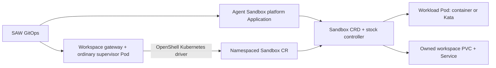

# Stock Kubernetes runtime dependencies

Status: stock controller/CRD installed on glmhg; retained identity resync passed;
**isolated container persistence testing passed and full SAW/Kata
qualification remains pending**. Both lab workers boot in BIOS, which fails
OSC 1.13's documented UEFI prerequisite. Installing this dependency does not enable the portal's container or
Kata provisioning gate. VM remains the default.

The first Kubernetes topology uses an ordinary supervisor Pod and a separate
workload Pod. Container mode uses the ordinary workload runtime; Kata mode assigns
Kata to the workload Pod only. This does not put the supervisor inside Kata.
OpenShell, Agent Sandbox and Kata binaries remain stock. There is no Kyverno
dependency or mutation webhook in this installation.

## Component and ownership boundary



| Component | Responsibility | Owner |
|---|---|---|
| Agent Sandbox CRD/controller | Reconcile a Sandbox's Pod, Service and `volumeClaimTemplates`; apply suspend/resume lifecycle | One platform installation per cluster |
| Stock OpenShell Kubernetes driver | Select served API; create/update Sandbox; provide workload template and supervise its lifecycle | Per-workspace gateway |
| Stock OpenShell supervisor | Workload supervision and the OpenShell boundary protocol | Ordinary Pod, separate from the workload |
| Kata RuntimeClass/operator | Run selected workload Pods in Kata VMs | Cluster platform; installed separately |
| OpenShift AdminNetworkPolicy | Restrict supervisor egress ahead of the driver's allow-all NetworkPolicy | Platform policy application |

The Agent Sandbox controller uses upstream **ClusterRole/ClusterRoleBinding** and
watches cluster-wide. It can create/update/delete Pods, PVCs and Services, manage
Sandboxes/status/finalizers, emit Events and use coordination Leases. It has no
Secret rule, but its ability to create Pods is a broad trust privilege: namespace
placement does not restrict its authority. Do not install one copy per workspace
or describe it as tenant-isolated RBAC. The optional extensions, warm pools,
router and conversion webhook are not installed.

## Locked dependency and API contract

[`charts/agent-sandbox/source-lock.yaml`](../charts/agent-sandbox/source-lock.yaml)
records the upstream release, commit, exact manifest SHA256 and multi-architecture
controller image-index digest. The checked-in manifest and Apache license are
unmodified upstream artifacts.

| Input | Pin / behavior |
|---|---|
| Agent Sandbox | `v1.0.9`, source `b1277676f8bf0e82ea299928997ecf5d696a92f1` |
| Controller image | `registry.k8s.io/agent-sandbox/agent-sandbox-controller@sha256:ef1a1a3076afc996e711c44b388fbb7ffb7cd6858953d7e685166b299d77bd38` |
| Sandbox API | `agents.x-k8s.io/v1beta1`; only served and storage version |
| Reviewed consumer | OpenShell `v0.1.2-rhaiv.6`, source `305c8b3d7bbdb97a6f2f7264c3ad43b0087c307f` |
| Reviewed fields | `podTemplate`, `volumeClaimTemplates`, `operatingMode: Running/Suspended` |

OpenShell discovers the Sandbox API and prefers `v1beta1`; its alpha fallback
cannot be used with this release. Restart gateways after an API-version migration
because discovery is cached. Leave `template.agent_socket_path` unset: OpenShell
can emit `spec.agentSocket`, which is not a property in this upstream CRD.
These are source/schema checks, not proof of live lifecycle compatibility.

The chart adds only deployment configuration: the locked image digest, resource
requests/limits, nonroot/drop-all/RuntimeDefault security settings, and health
probes. Upstream registers `/healthz` and `/readyz` on port `8081`; these are
controller process checks, not workload readiness or isolation checks. It does
not patch either controller source or CRD schema. OpenShift assigns the runtime
UID; no fixed UID or additional SCC grant is included.

## Install through GitOps

First choose one owner. If the platform already provides Agent Sandbox, leave
this chart disabled and verify that installation's API and lifecycle behavior.
**Do not adopt an existing CRD/controller or deploy a second controller through
this chart.** Inventory before enabling the application:

```sh
oc get crd sandboxes.agents.x-k8s.io --ignore-not-found
oc get deployments -A -l app=agent-sandbox-controller
oc get clusterrole,clusterrolebinding agent-sandbox-controller --ignore-not-found
```

For a new installation, add this optional application to the pattern's GitOps
configuration. Set the repository, immutable revision and allowed Argo project
for your fork; the project must permit these cluster-scoped CRD/RBAC resources.
The chart defaults to `enabled: false` and requires namespace
`agent-sandbox-system` when enabled.

```yaml
apiVersion: argoproj.io/v1alpha1
kind: Application
metadata:
  name: saw-agent-sandbox
  namespace: vp-gitops
spec:
  project: default # use the platform project permitted to install CRDs/RBAC
  source:
    repoURL: https://github.com/YOUR-ORG/secure-agent-workspace.git
    targetRevision: YOUR-REVIEWED-COMMIT
    path: charts/agent-sandbox
    helm:
      values: |
        enabled: true
  destination:
    server: https://kubernetes.default.svc
    namespace: agent-sandbox-system
  syncPolicy:
    automated:
      selfHeal: true
      prune: true
    syncOptions:
      - ServerSideApply=true
```

The chart owns Namespace, CRD, ServiceAccount, ClusterRole/Binding, Service and
Deployment. In-app sync waves order them; they do not order unrelated Argo
applications. Keep workspace creation disabled until the dependency health gate
passes. Argo uses its built-in Deployment health; no custom Sandbox health script
is installed or assumed. Namespace and CRD carry Helm retention and Argo
`Prune=false,Delete=false`: deleting or pruning an Application must not silently
delete every Sandbox. Intentional decommission requires a separate review of
Sandboxes and their PVC ownership before removing the retained resources.

For a registry mirror, set `controller.imageRepository`; the image digest remains
locked. Do not build an Agent Sandbox derivative image. Changing release or CRD
requires updating the manifest, lock, image and API compatibility review together.
The chart rejects a mismatched vendored manifest checksum.

## Qualification after installation

```sh
oc wait --for=condition=Established crd/sandboxes.agents.x-k8s.io --timeout=120s
oc -n agent-sandbox-system rollout status deploy/agent-sandbox-controller --timeout=180s
oc get crd sandboxes.agents.x-k8s.io \
  -o jsonpath='{range .spec.versions[*]}{.name}{" served="}{.served}{" storage="}{.storage}{"\n"}{end}'
oc -n agent-sandbox-system get deploy agent-sandbox-controller \
  -o jsonpath='{.spec.template.spec.containers[0].image}{"\n"}'
```

Expected: CRD Established; Deployment successfully rolled out; exactly
`v1beta1 served=true storage=true`; the locked digest above. Then test OpenShell
create/start/stop/resume/delete, PVC persistence on stop/resume, supervisor/workload
recovery and gateway egress policy. In Kata mode, independently verify the
workload's actual RuntimeClass/VM and that the supervisor remains an ordinary Pod.
Successful rollout alone must not open the portal qualification gate.

OpenShell stop suspends the Sandbox and retains its workspace PVC. Deleting the
Sandbox can garbage-collect its owned storage. Verify the intended deletion
contract with disposable data before exposing workspace deletion to users.

Do not upgrade an existing alpha installation directly to this chart: upstream
v1.0 removed `v1alpha1` and its conversion webhook. Follow the
[upstream API migration guide](https://github.com/kubernetes-sigs/agent-sandbox/blob/b1277676f8bf0e82ea299928997ecf5d696a92f1/docs/api-migration-guide.md),
including stored-version migration, before changing controllers.

Source evidence: [release artifacts](https://github.com/kubernetes-sigs/agent-sandbox/releases/tag/v1.0.9),
[controller health registration](https://github.com/kubernetes-sigs/agent-sandbox/blob/b1277676f8bf0e82ea299928997ecf5d696a92f1/cmd/agent-sandbox-controller/main.go),
[OpenShell driver contract](https://github.com/opendatahub-io/openshell/blob/305c8b3d7bbdb97a6f2f7264c3ad43b0087c307f/crates/openshell-driver-kubernetes/README.md).
