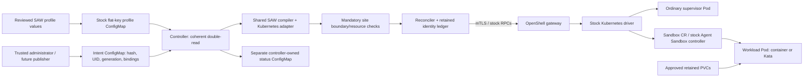

# ConfigMap-driven Kubernetes runtime controller

The controller runs on the qualification cluster. The VM backend remains the
supported default. See the [controller chart](../charts/saw-kubernetes-controller)
and [backend acceptance status](container-kata-implementation-plan.md). The controller reuses the SAW profile compiler and stock OpenShell RPCs;
it keeps OpenShell, Kata and Agent Sandbox stock, and introduces no CRD.

Implementation:
[`controller.py`](../kubernetes-runtime/saw_kubernetes/controller.py),
[`regression tests`](../tests/kubernetes_runtime/test_controller.py).
Runtime/dependency context:
[`runtime adapter`](../kubernetes-runtime/README.md),
[`stock dependencies`](container-runtime-dependencies.md).

## Data flow and responsibilities



| Component | Responsibility |
|---|---|
| Profile ConfigMap | Existing `charts/saw-bom` flat file keys and exact YAML strings; no new profile schema |
| Administrator intent ConfigMap | Approve one profile UID/content hash, monotonic generation, lifecycle intent and separately controlled storage/runtime bindings |
| Controller frontend | Read coherent inputs, reject replacements/conflicting generations, invoke compiler/checks/core, publish sanitized status |
| Shared compiler | Parse SAW semantics, then reject capabilities the Kubernetes adapter has not implemented |
| Core reconciler | Observe before stock RPC mutations, retain object identities, reconcile membership/providers/generic sandboxes and explicit stop/start |
| Site verification callbacks | Prove gateway/namespace identity, approved attachments, native admission/network enforcement and platform governance policy |

The canonical profile implementation is
[`saw_core.py`](../charts/openshell-saw/files/installer/saw_core.py). The VM
`apply_bom.py` loads it from the repository during development; the deployed VM
installer embeds those exact bytes inside `apply_bom.py`, covered by the
existing signing manifest. The Kubernetes compiler loads the same source
through its `core` module. Shared code covers parsing, validation, provider
selection, model/endpoint precedence, inference input resolution, harness/tool
policy and the workspace → providers → sandboxes readiness sequence. Each
backend retains its own execution, credential access and storage operations.
Container capability checks still reject unsupported BOM behavior before any
OpenShell mutation.

Data science therefore reuses the VM's two-sandbox BOM and public model inputs;
it does not have a separate profile implementation. The site renderer selects
the exact deployed BOM chart and derives the approval from its Helm output.
RHDH presents only the reviewed container profiles and checks the owner's
approval again on submission. See the [site installation and two-chat lifecycle
recipe](container-site-replay.md#5-qualify-data-science-browser-chat-and-lifecycle).
Shipping a shared source change requires rebuilding and selecting a new
controller image digest; changing its Git revision input alone does not update
an existing Pod.

The frontend never writes either desired ConfigMap. It never deletes ConfigMaps,
workloads or PVCs. A missing source is a blocked reconciliation, **not** a request
to stop or remove an existing workload.

Explicit `Stopped` intent uses the identity-checked shutdown path. It can stop
previously recorded sandboxes even after PVC approval revocation, without creating
or repairing dependencies. Namespace/gateway/workspace/sandbox identity checks
remain; same-name replacements and unrecorded objects are refused. The normal
full prerequisite checks still gate `Running`. This does not add automatic prune.

## Exact input contract

Construct one `Scope(namespace, profile_name, bindings_name, status_name, owner_id)`.
The names are explicit and distinct; only those ConfigMaps are accessible through
the supplied HTTPS client. `owner_id` is a stable canonical, nonzero UUID. Binding
configuration `ownerID` and `namespace` must match this scope.

The profile ConfigMap retains the existing flat keys. This illustrative fragment
shows a generic sandbox; substitute an approved image digest. It is not an
installation manifest for the complete runtime:

```yaml
apiVersion: v1
kind: ConfigMap
metadata:
  name: saw-alice-bom
  namespace: saw-alice
data:
  profiles__developer__default__workspace.yaml: |
    apiVersion: saw.redhat.com/v1alpha1
    kind: Workspace
    metadata:
      name: default
  profiles__developer__default__sandbox.yaml: |
    apiVersion: saw.redhat.com/v1alpha1
    kind: Sandboxes
    spec:
      sandboxes:
        - name: toolbox
          type: generic
          image: registry.example.test/toolbox@sha256:<approved-64-hex-digest>
          providers: []
```

The intent ConfigMap has **exactly one data key**, `intent.json`. Its label binds
it to the administrator-selected installation. Labels alone are not authorization:
RBAC/admission must prevent workspace users and agent Pods from changing this
ConfigMap or its approval metadata.

```yaml
apiVersion: v1
kind: ConfigMap
metadata:
  name: saw-runtime-intent
  namespace: saw-alice
  labels:
    saw.redhat.com/runtime-owner: b032b2e4-2cd5-47a7-8ef8-ac73e15700b1
data:
  intent.json: |
    {
      "schemaVersion": 1,
      "generation": 1,
      "desiredState": "Running",
      "profileRef": {
        "name": "saw-alice-bom",
        "uid": "<observed-profile-ConfigMap-UID>",
        "sha256": "<SHA256-of-canonical-profile-data>"
      },
      "bindings": {
        "ownerID": "b032b2e4-2cd5-47a7-8ef8-ac73e15700b1",
        "namespace": "saw-alice",
        "namespaceUID": "<observed-namespace-UID>",
        "ownerSubject": "<validated-owner-subject>",
        "mode": "container",
        "gatewayVersion": "0.1.2-rhaiv.6",
        "approvedCredentialFreeProviders": [],
        "bindings": {
          "default/toolbox": {
            "workspace": {
              "claimName": "alice-toolbox-workspace",
              "uid": "<observed-PVC-UID>",
              "readOnly": false
            },
            "mounts": [{
              "claimName": "alice-toolbox-data",
              "uid": "<observed-data-PVC-UID>",
              "readOnly": false,
              "mountPath": "/data"
            }]
          }
        }
      }
    }
```

For workload-only Kata, use `mode: kata` in the JSON bindings and add
`workloadRuntimeClass` plus `workloadRuntimeClassUID`. The supervisor remains an
ordinary Pod. Refer to the runtime adapter for PVC approval labels,
`Prune=false,Delete=false`, resource limits and supported profile fields.

| Field | Rule |
|---|---|
| `schemaVersion` | Integer `1`; no extra envelope keys |
| `generation` | Positive integer; increment for every desired content or state change, including each stop/start cycle |
| `desiredState` | `Running` or `Stopped` |
| `profileRef` | Exact allowlisted name, observed UID and hash of the complete profile `.data` map |
| `bindings` | Administrator configuration consumed by `compile_profile_files`; no credentials |

Hash the **exact string values returned in ConfigMap `.data`**, including trailing
newlines, with sorted JSON keys, compact separators and ASCII escapes:

```python
import hashlib
import json

def profile_data_sha256(data):
    canonical = json.dumps(data, sort_keys=True, separators=(",", ":"), ensure_ascii=True)
    return hashlib.sha256(canonical.encode()).hexdigest()
```

Do not hash the entire Kubernetes object or a locally reserialized YAML document.
`resourceVersion` is opaque and is not an integer generation. On first bootstrap,
the profile must exist before a trusted publisher can observe its UID and produce
the matching intent. That GitOps publishing/bootstrap automation is not implemented
by this frontend; a placeholder UID/hash cannot qualify an installation.

### Generate the intent locally

The implemented dry-run builder takes an already captured profile ConfigMap JSON
and administrator bindings YAML. It reads only its named local inputs, validates
the full profile through the shared compiler, and writes one ConfigMap JSON to
stdout. It does not contact Kubernetes, read credential files, apply manifests or
enable provisioning. From the repository root:

```sh
PYTHONPATH=kubernetes-runtime python3 -m saw_kubernetes.intent \
  --profile-configmap observed-profile.json \
  --bindings admin-bindings.yaml \
  --name saw-runtime-intent \
  --generation 1 \
  --desired-state Running > intent.json
```

`observed-profile.json` must contain `apiVersion: v1`, `kind: ConfigMap`,
`metadata.name`, `metadata.namespace`, a canonical nonzero UUID `metadata.uid`,
`metadata.resourceVersion` and exact `.data`. The builder does not invent missing
identities. A local file is not authenticated live evidence: the controller still
rechecks it against Kubernetes. `admin-bindings.yaml` contains the object nested
under `bindings` in the example above, not the entire intent envelope.

Expected: exit `0`, no stderr, and `intent.json` containing `kind: ConfigMap`,
name `saw-runtime-intent`, the runtime-owner label, and one `data["intent.json"]`
string with the computed `profileRef.sha256`. Invalid/unsupported input exits `1`
with a fixed error classification and **empty stdout**. JSON/YAML duplicate keys
are rejected. Shell redirection can still create an empty output file on failure;
check the exit status before reviewing or handing it to a trusted publisher.

For an update, supply the existing intent ConfigMap JSON and increment generation:

```sh
PYTHONPATH=kubernetes-runtime python3 -m saw_kubernetes.intent \
  --profile-configmap observed-profile.json \
  --bindings admin-bindings.yaml \
  --name saw-runtime-intent \
  --generation 2 \
  --desired-state Stopped \
  --previous-intent previous-intent.json > next-intent.json
```

An exact same-generation retry is accepted. Changed content/state at the same
generation, generation rollback, another owner/scope, or a changed profile UID is
rejected. Without `--previous-intent`, the builder cannot know prior generations;
the controller's retained ledger remains authoritative. Successful generation is
an input-validation result, not runtime qualification or authorization to bypass
the provisioning gate.

## Snapshot, lifecycle and recovery

Each pass reads intent, reads the referenced profile, checks its UID/hash, and
re-reads both objects. Changes during that read reject the snapshot. The intent
therefore declares the accepted profile revision even when GitOps updates the two
ConfigMaps at different times. Sources may be mutable ConfigMaps; this does not
require `immutable: true`.

The retained frontend ledger records the scope, both source UIDs, the accepted
generation and an input content hash. Before core mutations, the controller fences
that intent on disk. The core separately retains OpenShell workspace/provider/
sandbox identities and observes ambiguous RPC results on subsequent passes.

| Event | Behavior |
|---|---|
| Same inputs/generation | Re-observe through the core; unchanged status is not rewritten |
| Profile updated before matching intent | Block with `InputRevisionMismatch`; leave the current workload running |
| Matching revision and higher generation | Compile/check/apply the supported intent; frontend acceptance does not imply arbitrary migration support |
| Changed intent at the same generation, or older generation | Block with `StaleOrConflictingGeneration` |
| Same-name input recreated with another UID | Block with `InputIdentityReplaced`, even if its content matches |
| Input absent or deleting | Block; never infer stop, purge or PVC deletion |
| `Stopped` with coherent valid inputs | Request the core's supported stop lifecycle; preserve Sandbox/PVC identity |
| Controller restart | Load retained identities/generation, re-read sources, observe the gateway before further mutations |

Do not erase the ledger to bypass a replacement check. An explicit, reviewed
rebind/recovery operation is still needed. Removing objects from the desired
profile is not an implemented prune workflow. Existing sandbox configuration
changes can still require migration that the core refuses to perform.

The frontend runs the full boundary check for `Running`. Explicit `Stopped`
delegates to the core's identity-checked shutdown path, so revoked network or
attachment approval does not prevent stopping a previously recorded sandbox.
Coherent inputs, monotonic generations, namespace identity and recorded gateway,
workspace and sandbox IDs remain mandatory. This is not an adoption or purge path.

## Status and ownership

Only the separately named status ConfigMap is writable. It carries:

```yaml
metadata:
  name: saw-runtime-status
  namespace: saw-alice
  labels:
    saw.redhat.com/runtime-owner: b032b2e4-2cd5-47a7-8ef8-ac73e15700b1
    saw.redhat.com/managed-by: kubernetes-runtime-controller
data:
  status.json: |
    {"schemaVersion":1,"phase":"GenericReady","reason":"CoreObserved","observedGeneration":1,"inputRevision":"<content-hash>","retryAfterSeconds":30}
```

`phase` is `Blocked`, `Retry`, `Pending`, `GenericReady` or `Stopped`.
`GenericReady` preserves the core's narrow meaning: configured generic sandboxes
report Ready through the stock gateway. It does not certify inference, agent
profiles, native policy enforcement or a Kata VM boundary.

`observedGeneration` means a coherent snapshot was read, not that it converged;
inspect `phase` and `reason`. `inputRevision` hashes the decoded intent plus flat
profile data. It is distinct from the compiled plan's core `desiredRevision`.
Incomplete snapshots may have neither field. Exception strings, provider details,
tokens, request bodies and arbitrary core response fields are never published.

Status updates use the observed `resourceVersion`, retry at most three conflicts,
and preserve existing metadata. A foreign status owner blocks core work. Failure
to publish status never causes a desired ConfigMap rewrite; the caller receives
`statusPublished: false` when publication fails. Keep status `.data` outside Argo's
desired resources so self-healing does not compete with the controller.

## Host wiring and security requirements

The following is a host integration interface, **not a runnable installation
shortcut**. The caller must provide real authenticated resource readers and
boundary checks. There is deliberately no no-op/default verifier:

```python
from pathlib import Path
from saw_kubernetes import Reconciler, compile_profile_files
from saw_kubernetes.controller import ConfigMapClient, Controller

def serve(*, scope, api_server, api_ca_file, projected_token_file,
          state_directory, gateway, verify_resources, verify_boundary,
          stop_requested):
    # gateway: authenticated stock GrpcGateway with verified CA and client mTLS.
    # verify_resources: live namespace/PVC/RuntimeClass identity and approval checks.
    # verify_boundary: live gateway-to-namespace identity, native admission/ANP,
    #                  and platform governance/policy verification.
    api = ConfigMapClient(api_server, scope, api_ca_file, projected_token_file)
    state = Path(state_directory)
    core = Reconciler(gateway, state / "core", verify_resources)
    controller = Controller(api, scope, state, compile_profile_files,
                            core.reconcile, verify_boundary)
    controller.run(stop=stop_requested)
```

- Run **one replica** with a retained private filesystem that supports POSIX
  locking. The frontend holds `controller-frontend/reconcile.lock` for the entire
  loop; the core has a separate per-pass lock. This is not a Kubernetes Lease,
  distributed fencing protocol or HA design. Do not run independent replicas with
  separate copies of state. Retain state together with gateway identity/database.
- HTTPS verifies the configured API CA, refuses redirects, rereads the projected
  service-account token for each request, and bounds response size and timeouts.
  Give that token only to the controller, never the agent workload.
- Reads are allowlisted to the three ConfigMap names. Only the intent is watched,
  using `metadata.name` field selection. Watch expiry/HTTP 410 causes fresh named
  GETs; watch loss or profile-only changes are covered by bounded resync. Retry
  and resync intervals are capped at 30 seconds; EOF/error streams do not spin.
- Enforce corresponding RBAC and native admission. Kubernetes `create` cannot be
  constrained by [`resourceNames`](https://kubernetes.io/docs/reference/access-authn-authz/rbac/#referring-to-resources);
  the library's status-only write check is not an
  authorization boundary. Either constrain creates through platform admission or
  precreate correctly owned status and omit create permission. Protect input and
  status writers from tenant access. Additional resource-verifier permissions are
  separate from the named-ConfigMap client.
- Preserve the namespace and retained PVCs. Argo annotations and local locks do
  not survive an administrator deleting the namespace or PVC; controlled purge
  and recovery remain separate operations.

## Evidence and remaining work

The **38 frontend tests** exercise fake Kubernetes API snapshots, watches, 410
recovery, bounded retry, CAS conflicts, ownership, generation/UID persistence,
status sanitization and projected-token rotation. One test composes the real
shared compiler and reconciler with a fake stock gateway through create, controller
restart and stop. HTTPS is tested through injected transport; no live cluster,
TLS handshake, CNI enforcement, Pod creation or Kata isolation was exercised.

The local intent builder also has focused unit/CLI coverage for exact hashes,
observed identity, whole-profile validation, update fencing, duplicate fields and
sanitized failures. Its successful output has not been applied to a live cluster.

Useful next offline work, before opening any provisioning gate:

1. Contract tests for a future trusted GitOps publisher consuming the dry-run
   builder output; review bootstrap ownership and conflict handling before any
   automatic publication capability.
2. Policy-verifier contract tests against captured, sanitized Kubernetes objects;
   then implement real gateway identity, native network/admission and governance
   checks without approval-label shortcuts.
3. Controller packaging and explicit RBAC/admission/retained-state ownership tests,
   with install disabled until qualification; test graceful termination and
   recovery around ambiguous mutations and status conflicts.
4. Explicit recovery design for replaced sources, lost state and safe stop after
   approval revocation. Add fault tests before permitting automatic recovery.

Live acceptance still requires the documented VM baseline, stock dependency
installation, controller credentials and persistent state, generic-workload
positive/negative lifecycle tests, workload-only Kata verification, and completion
of the missing agent/harness/credential/UI/RHDH lifecycle adapters. This frontend
does not close those gaps or enable container/Kata provisioning in the portal.

For a controller or image change, generate the new intent with `--pin-plan`
from the reviewed source revision. This binds the compiled gateway request
(including workload environment, command, image and PVC attachment) to the
intent. An older controller rejects the new reference format or reports
`CompiledPlanMismatch` before issuing a mutation. Wait for the new controller
Deployment rollout before publishing the intent. Use a higher generation for
the change. Legacy intents remain readable.
