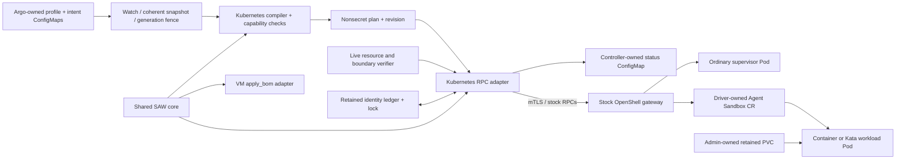

# Stock OpenShell Kubernetes reconciliation foundation

Status: **offline-tested foundation; not installed, not full SAW parity, not a
qualified container/Kata deployment**. VM profile code has been extracted into a
shared core while preserving the VM install/apply behavior and signed-bundle format.

Both frontends now use the canonical
[`saw_core.py`](../charts/openshell-saw/files/installer/saw_core.py): profile models,
parsing, semantic validation, credential-reference helpers and workspace apply
sequencing. Container and Kata use the same Kubernetes adapter. Provider mutation,
agent onboarding, migration and retention semantics are **not yet fully unified**;
the unsupported Kubernetes capabilities below still fail compilation.

[`controller.py`](saw_kubernetes/controller.py) adds the ConfigMap watch/status
frontend. It consumes a coherent profile plus administrator-intent revision, fences
input identities/generations, invokes the compiler/reconciler and writes a separate
status ConfigMap. See the [input and lifecycle contract](../docs/kubernetes-controller-inputs.md).
A new SAW CRD is deferred. `Workspace`, `Providers` and `Sandboxes` remain profile
documents; OpenShell owns the stock Agent Sandbox CRs. The frontend is implemented,
but its production deployment, boundary verifier and portal wiring remain pending.

This integration uses the stock OpenShell API and Kubernetes driver from
[`305c8b3`](https://github.com/opendatahub-io/openshell/tree/305c8b3d7bbdb97a6f2f7264c3ad43b0087c307f)
(`v0.1.2-rhaiv.6`). It adds no OpenShell, Kata or agent-image patches.

## Components and flow



| Component | Responsibility |
| --- | --- |
| `saw_core.py` | Canonical profile models/schema, common validation and workspace → provider → sandbox sequencing, used by VM and Kubernetes |
| `controller.py` | Read/watch allowlisted ConfigMaps, check coherent input hashes/UIDs, fence generations, publish sanitized status with optimistic concurrency |
| `intent.py` | Validate local profile/administrator inputs and generate the exact intent ConfigMap with a content hash; no API calls or apply |
| `compiler.py` | Use the shared core and validate backend capabilities before any mutation; resolve only administrator-selected attachments; emit stock protobuf request dictionaries and a stable desired revision |
| `reconcile.py` | Observe before writing; serialize apply; retain object IDs; reconcile owner membership, providers and sandboxes; handle bounded retries and generation-aware stop/start |
| `GrpcGateway` | Send the allowlisted stock RPCs using generated Python stubs, verified TLS and an explicit client identity; no insecure channel or credential logging |
| `KubernetesResourceVerifier` | Re-read namespace/PVC/RuntimeClass identities and approval labels before every apply; reject deleting/replaced/unapproved attachments |
| `OcReader` | Read only Namespace, PVC and RuntimeClass JSON through the caller's existing authenticated `oc` configuration |
| External boundary verifier | Mandatory integration callback: verify native admission/network enforcement, gateway-to-namespace identity and platform governance/policy; approval labels alone are insufficient |

The shared sequencer waits for workspace preparation before providers and for all
providers before sandboxes. It visits all peers at each stage, so one pending
provider does not starve another. VM-specific preparation, credential handling,
error aggregation and pruning remain in its adapter; Kubernetes observations,
request IDs and requeue behavior remain in its adapter. This is shared stage
ordering, not a claim that all lifecycle decisions are already common.

The VM chart embeds the exact core bytes into the existing signed `apply_bom.py`.
The fixed signed-file list and existing golden-image verifier remain compatible;
there is no adjacent unsigned module import in the rendered installer. The signer
rejects an unrendered, malformed or noncanonical embedding. Local source uses the
exact repository module, never a profile-selected import. No golden-image rebuild
is required solely for this extraction.

The reconciler does not create Pods, patch the driver's objects, format storage,
read Kubernetes Secrets, delete PVCs or install dependencies. Gateway/provider
credentials are not compiled into the plan.

## Supported input subset

The profile directory uses the existing `charts/saw-bom/profiles/<profile>/<workspace>/`
layout: `workspace.yaml`, `providers.yaml`, `sandbox.yaml`.

- Enabled **generic** sandboxes only, with an immutable image digest and the same
  idle command used by the existing generic installer: `sh -c 'sleep infinity'`.
- Optional **credential-free**, administrator-approved provider types. At apply,
  each must resolve to a credential-free platform profile from the governance
  interceptor. Workspace-local replacements are insufficient.
- One pre-existing, writable filesystem PVC mounted at `/sandbox`, plus approved
  additional non-overlapping mounts at `/data` or below it. Both mount and PVC
  `read_only` fields are explicit in the stock driver configuration.
- `container`: ordinary workload runtime. `kata`: the administrator-selected stock
  workload RuntimeClass. **The supervisor remains an ordinary Pod in both modes.**
  `requestedPlacement` reports desired placement, not independently observed VM
  boundaries. Native admission and live checks must prevent runtime fallback.

Enabled OpenClaw/NemoClaw, harnesses, UI exposure, inference/model settings,
credential-bearing providers, environment injection, arbitrary driver configuration
and unsupported profile fields **fail compilation**. The stock `data-science`
profile therefore does not work through this foundation yet; it is not silently
reduced to a generic sandbox. Disabled optional entries produce no resources.

Administrator bindings are separate from user profile YAML:

```yaml
ownerID: 2816a4ee-ff19-4d21-aebd-55e27d791941 # stable installation UUID
namespace: saw-alice
namespaceUID: <observed-namespace-uid>
ownerSubject: <validated-oidc-subject>
mode: container
gatewayVersion: 0.1.2-rhaiv.6 # must match GetGatewayInfo exactly
approvedCredentialFreeProviders: []
bindings:
  default/toolbox:
    workspace:
      claimName: alice-toolbox-workspace
      uid: <observed-pvc-uid>
      readOnly: false
    resources:
      requests: {cpu: 250m, memory: 512Mi}
      limits: {cpu: "2", memory: 2Gi}
    mounts:
      - claimName: alice-toolbox-data
        uid: <observed-data-pvc-uid>
        mountPath: /data
        readOnly: false
```

For workload-only Kata, set `mode: kata`, `workloadRuntimeClass` and
`workloadRuntimeClassUID`. A missing class fails; it never selects the default
runtime. Supervisor placement is not configurable through this integration.

Do not accept binding files from workspace users. The cluster administrator must
own the namespace, approval labels, admission policy and PVC provisioning. Namespace
labels must bind `saw.redhat.com/runtime-owner` to `ownerID`. Each PVC must have:

```yaml
metadata:
  labels:
    saw.redhat.com/runtime-owner: <ownerID>
    openshell.ai/sandbox-attachable: "true"
    openshell.ai/sandbox-attachable-workspace: default
  annotations:
    argocd.argoproj.io/sync-options: Prune=false,Delete=false
```

PVCs must have no garbage-collecting owner references. Both Argo options are
required: `Prune=false` covers synchronization; `Delete=false` retains the PVC
when its owning Application is deleted. Neither prevents namespace deletion or
direct administrative deletion. RuntimeClasses need the
stock `openshell.ai/sandbox-attachable: "true"` approval label. Stock
`Scope::Shared` / `admit_shared` deliberately skips workspace-dependent labels
for RuntimeClass, so an approved class can be shared by multiple workspaces;
the workspace label remains mandatory on each data-bearing PVC. The gateway's stock
`allow_driver_config` gate and resource admission must be enabled consistently.
This verifier adds checks; it does not replace driver admission.

## Compile and test without a cluster

Python 3.10+, PyYAML and pytest are sufficient for compilation/unit tests; no images
or OpenShell binary are downloaded. From the repository root:

```sh
PYTHONPATH=kubernetes-runtime python3 -m saw_kubernetes \
  --profile <generic-profile-directory> --bindings <admin-bindings.yaml>

PYTHONDONTWRITEBYTECODE=1 python3 -m pytest -q -p no:cacheprovider \
  --basetemp=/tmp/saw-k8s-runtime-tests tests/kubernetes_runtime
```

The first command prints a nonsecret compiled plan and performs **no mutations**.
Do not interpret a compiled plan as proof that its PVC UIDs, admission policy,
image digest or kernel capabilities have been checked against a live cluster.

For the ConfigMap frontend, `python3 -m saw_kubernetes.intent` builds the intent
from an observed profile ConfigMap JSON and local administrator bindings. Its
optional `--previous-intent` catches stale/conflicting generations before
publication. It emits JSON only; Argo still owns applying desired configuration.
See the [commands and required inputs](../docs/kubernetes-controller-inputs.md).

Unit tests exercise fake gateway observations, including ambiguous create timeouts,
process restart, stop/start cycles, stale generations, cross-owner objects,
same-name replacement, spec drift, revoked PVC approval, WFFC Pending claims and
unsupported privilege/mount/profile inputs. They do not qualify gRPC connectivity,
real provider inference, CNI enforcement or Kata kernel behavior.

### Stock protobuf and generated-stub test

The separate test runner checks the **actual pinned API**, not just matching
Python dictionaries. In an isolated Python 3.11+ environment, provide
`pytest`, `PyYAML`, `grpcio-tools==1.80.0`, `grpcio==1.80.0`, `protobuf==6.33.1`,
`httpx` and `googleapis-common-protos`. Then run:

```sh
PYTHONDONTWRITEBYTECODE=1 python3 kubernetes-runtime/test-stock-protobuf.py \
  --openshell-source /path/to/pinned-openshell-checkout \
  --scratch-parent /tmp
```

The checkout must be at
`305c8b3d7bbdb97a6f2f7264c3ad43b0087c307f`, with unchanged tracked protocol/SDK
sources. The runner copies only protocol/Python sources into temporary storage,
uses the **stock** `tasks/scripts/generate_python_proto.py`, and removes its scratch
directory afterward. It never installs dependencies, opens a socket or edits the
checkout. The default unit-test command skips this optional wire-test module;
the runner enables it and fails if dependencies or generated imports are missing.

The generated `OpenShellStub` serializes real protobuf requests to bytes through
an in-memory channel. Official input/output descriptors also validate the fake
server's responses, including enum conversion and `google.protobuf.Struct`
mount flags. Tests cover create/observe/stop/start, non-default workspaces,
memberships, providers, request IDs, unknown-field rejection, bounded deadlines
and ambiguous create followed by process restart. They also check stock
restart/attachment defaults and reject unsupported environment/GPU/restart drift.
**This does not test a live
gateway, TLS handshake or OpenShift admission.**

Verified offline result: **75 tests passed**, including nine generated-stub tests.
No upstream component source was changed. The temporary macOS CPython 3.13
`grpcio_tools-1.80.0` wheel used for this check was verified against PyPI SHA-256
`a447f28958a8fe84ff0d9d3d9473868feb27ee4a9c9c805e66f5b670121cec59`;
other platforms require their own published wheel hash.

## Reconciler integration contract

Call `Reconciler(rpc, state_directory, verify_resources).reconcile(plan,
generation=<monotonic-int>, desired_state="Running"|"Stopped")` from the trusted
controller. Increment the intent generation on **every** desired revision or state
change, including repeated stop/start cycles. Reusing a generation with different
intent, rolling it back, changing the owner/mode or replacing recorded object IDs
fails before further mutation.

The RPC adapter accepts dictionaries using the field names in the pinned
[`openshell.proto`](https://github.com/opendatahub-io/openshell/blob/305c8b3d7bbdb97a6f2f7264c3ad43b0087c307f/proto/openshell.proto).
`GrpcGateway` requires `grpcio`, `protobuf` and generated `openshell._proto` modules
from that source. They are **not vendored or installed by the compiler**; the
optional runner above generates them only in scratch. Do not substitute an
arbitrary latest SDK. It uses explicit `workspace_scope`, per-target
UUID request IDs, bounded deadlines and no automatic mutation replay. An ambiguous
result is resolved by a fresh GET on the next pass; matching owned objects are
adopted, foreign objects and same-name replacements are refused.

Core return states are `Pending`, `Retry`, `GenericReady` and `Stopped`. The
ConfigMap frontend additionally reports sanitized `Blocked` reasons and API retries.
`GenericReady` means the stock gateway reports the configured generic sandboxes
Ready. It does not mean an agent, inference request, RHDH flow or real runtime
boundary passed acceptance. The ConfigMap frontend schedules bounded retries using
`retry_after_seconds`; authentication/authorization/precondition failures remain
errors. Error strings do not include RPC bodies or gateway-provided error details.

Observed sandbox configuration must match the compiled template, providers,
command and TTY. Unexpected environment, GPU requirements, log-level overrides,
restart behavior or unknown spec fields fail reconciliation. The pinned gateway
normalizes restart policy to `Never` and owns `provider_attachment_epoch`; those
defaults do not count as drift. Platform-governed sandbox `policy` is not owned
or compared by this adapter. Its enforcement must be checked by the external
boundary verifier and live policy tests; `GenericReady` does not attest it.

Run **one active reconciler per installation**, with its state on persistent,
private storage. The filesystem lock coordinates processes sharing that state;
it is not a distributed lease or an HA design. Retain the state with gateway DB
and identity. The boundary verifier must actually check the site's ANP/admission
foundation and gateway/governance identity and policy. The in-cluster entry point wires the verifier in `saw_kubernetes.boundary` to
the Kubernetes API. It compares approved object UIDs and spec/data digests,
checks admission type checking, OVN zone realization and rule priority, and
requires completed gateway, governance and proxy rollouts. Inspect the policies
and effective permissions before approving the initial snapshot. Rerun the
review after upgrades or object replacement. The offline administrator command
`python3 -m saw_kubernetes.audit config.json` emits candidate pins. Keep approval
outside the controller. Verify packet-level isolation independently.

## Persistence and remaining gaps

The stock driver skips its native workspace PVC when an explicit `/sandbox`
attachment exists. This avoids making the claim a child of the Sandbox CR, but
also skips native image-content seeding. The initial generic example must work
with a blank workspace. Image seeding, versioned migrations, harness/tool-gate
population and audit collection remain unimplemented.

Stop/start preserves the existing Sandbox and PVC identities. Removal from desired
state does not prune anything. Missing or changed sandboxes require explicit
recovery; the reconciler never deletes/recreates them to make a check pass. Argo
prune protection does not survive namespace deletion or an administrator deleting
the PVC: the caller must preserve the namespace and provide a separate explicit
purge workflow.

Remaining before full B5/B6/D1 delivery: credential-proxy marker adapter and
rotation, all agent launch/harness/tool/audit adapters, provider-update readiness,
profile migrations, retained-volume initialization, UI/relay integration, portal lifecycle
status wiring, and end-to-end acceptance of each supported agent.
The [controller chart](../charts/saw-kubernetes-controller) runs one controller in
the trusted namespace using an immutable image, a retained ledger PVC, a projected
API token and the gateway mTLS identity. GitOps owns the profile and intent.
The controller owns only the data in the precreated status ConfigMap. Configure
Argo to ignore that field on the named object and respect differences on sync.
The workload receives neither controller identity. Build the controller with
`kubernetes-runtime/Containerfile` from repository root. Its build stage verifies
the upstream SDK source hashes before generating the gRPC client.
`Stopped` now uses a separate shutdown path: namespace ownership/UID, authenticated
gateway version/driver, and previously retained workspace/sandbox IDs must match.
It can stop known resources after attachment approval is revoked or a boundary
prerequisite fails, without creating memberships, providers or workspaces. It
includes retained sandboxes removed from current desired membership; unrecorded
or replaced objects are rejected. New, empty stopped intent creates nothing.
`KubernetesResourceVerifier.verify_shutdown` checks namespace identity only; all
attachment/boundary checks remain mandatory for running/start. A custom verifier
defaults to its full check unless it explicitly supplies `verify_shutdown`.
Shutdown does not delete storage or bypass gateway authentication.
The original VM baseline must still pass before live candidate qualification.

## Test a retained generic toolbox

Use the ordinary owner's OIDC gateway login with verified TLS. Supply the
cluster's API service IP and a Python 3 toolbox. Start only after
`GenericReady`. Record the sandbox ID, workload and supervisor Pod UIDs, PVC
UID and PV name. The marker is unique per run.

```bash
check=./kubernetes-runtime/check-toolbox.sh
nonce=$(openssl rand -hex 16)
"$check" "$GATEWAY" "$WORKSPACE" "$SANDBOX" write "$nonce"
"$check" "$GATEWAY" "$WORKSPACE" "$SANDBOX" deny-api "$API_SERVICE_IP"
```

Using an independent nonmember's OIDC login, run the following against the
same gateway, workspace and sandbox. Expect `NONMEMBER_DENIED`.

```bash
"$check" "$GATEWAY" "$WORKSPACE" "$SANDBOX" nonmember -
```

Through Git, advance the intent generation and set `desiredState: Stopped`.
Wait for status `Stopped` and the old workload Pod to disappear. Advance the
generation again and set `Running`. Wait for `GenericReady`, verify the new
Pod UIDs, original sandbox ID and original PVC/PV. With the owner's login:

```bash
"$check" "$GATEWAY" "$WORKSPACE" "$SANDBOX" read "$nonce"
```

`PVC_READ_OK` confirms the original marker survived. This removes that marker.
For failed creates, inspect the **first** gateway rejection and the matching
interceptor decision. Later retries can report an unresolved request ID. Check
the gateway, Kubernetes objects and retained ledger before issuing a corrected
generation. Preserve the PVC and state throughout recovery.
